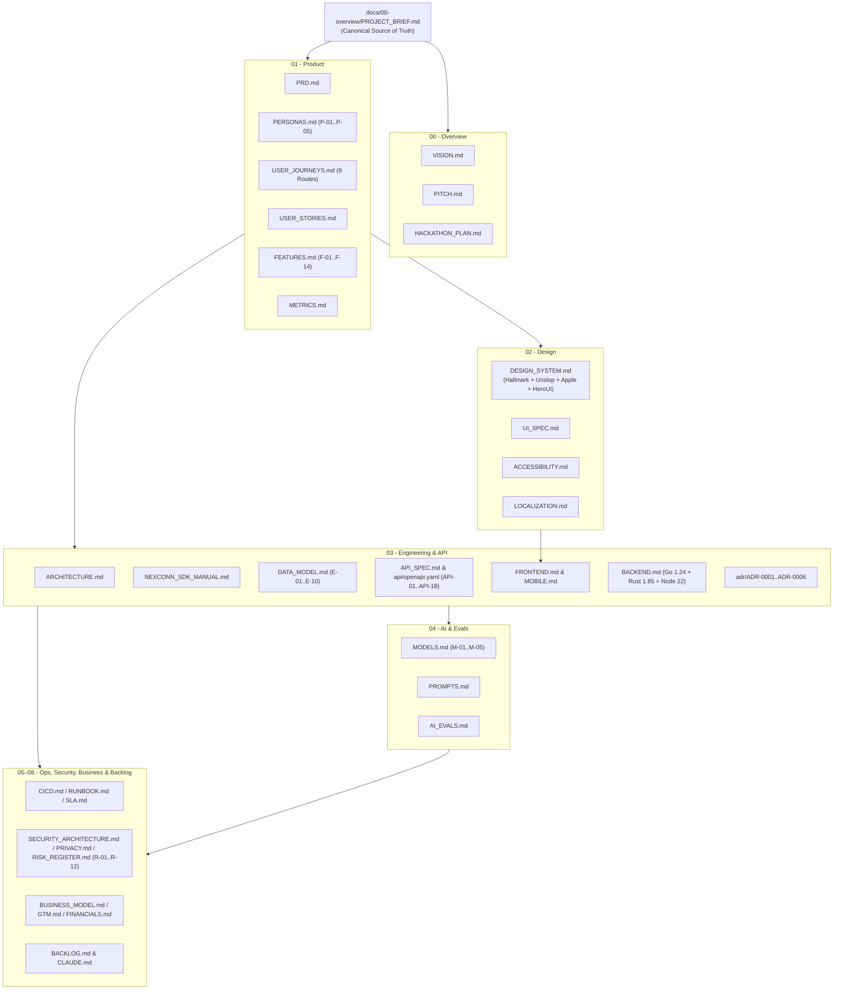

# MAP.md - Master Navigation Guide for MUDRA-OS (`SamvadDeal`)

Welcome to the **MUDRA-OS (`SamvadDeal`)** repository bible (`PS-03 Marketplace & Support`, **Nexconn Build Challenge 2026**, Team `Chanakya`). Every document in this repository derives its canonical IDs (`F-01`..`F-14`, `P-01`..`P-05`, `E-01`..`E-10`, `API-01`..`API-18`, `M-01`..`M-05`, `R-01`..`R-12`, `ADR-0001`..`ADR-0006`) from **[`docs/00-overview/PROJECT_BRIEF.md`](docs/00-overview/PROJECT_BRIEF.md)**.

---

## 1. Full Repository Directory Tree (One-Line Purpose per File & Folder)

```text
mudra-os/
├── README.md                                  # Front door: problem, PS-03 mapping, 9-route story flow, Go/Rust/Node stack, quick start
├── MAP.md                                     # This file: complete directory map, lookup table, dependency graph & reading orders
├── CLAUDE.md                                  # Primary instructions, build/test/eval commands & golden rules for AI coding agents
├── AGENTS.md                                  # Universal AI agent pointer to CLAUDE.md + non-negotiable architectural invariants
├── CONTRIBUTING.md                            # Local setup, trunk-based branch naming, Conventional Commits & PR Definition of Done
├── SECURITY.md                                # Supported versions, security invariants, NEXCONN_SECRET_KEY isolation & SLA reporting
├── CHANGELOG.md                               # Keep a Changelog release history ([Unreleased] & [0.1.0] - 2026-11-10)
├── CODE_OF_CONDUCT.md                         # Contributor Covenant v2.1 standards for repo and live Nexconn demo channels
├── .env.example                               # Complete environment variable template grouped by service (zero real secrets)
│
├── .github/
│   └── workflows/
│       ├── ci.yml                             # PR gate: Node/React + Go 1.24 race tests + Rust 1.85 clippy + OpenAPI + sloplint
│       ├── deploy.yml                         # Production CD: GHCR multi-arch images + Cloudflare Pages + Fly.io canary + rollback
│       └── ai-evals.yml                       # Nightly & PR AI evals: M-01..M-05 accuracy + Rust DPDP PII 1.000 recall gate
│
├── api/
│   └── openapi.yaml                           # OpenAPI 3.1 contract for all 18 endpoints (API-01..API-18) across Node, Go & Rust
│
├── apps/
│   ├── web/
│   │   └── src/                               # React 19 + Vite 6 + Tailwind v4 + @heroui/react v3 + Lit v3 + Nexconn ChatUI/Call
│   └── mobile-expo/
│       └── src/                               # Expo SDK 53 + React Native 0.76 + heroui-native v2 + uniwind field companion
│
├── services/
│   ├── nexconn-bridge-node/
│   │   └── src/                               # (:4001) Node.js 22 + Fastify 5 hosting @nexconn/server-sdk@0.1.2 + Gemini + Bhashini
│   ├── deal-engine-go/
│   │   ├── cmd/server/                        # (:4002) Go 1.24 entrypoint for deterministic <1.2ms Escrow FSM & /traction telemetry
│   │   └── internal/fsm/                      # Go 1.24 optimistic-locked 8-state Escrow FSM, Redis idempotency & HMAC webhooks
│   └── assay-verifier-rs/
│       └── src/                               # (:4003) Rust 1.85 Axum service: <300us DPDP PII scrub, <5ms DCT pHash, FFT & Ed25519
│
├── packages/
│   ├── nc-lit-cards/
│   │   └── src/                               # Lit 3.3.2 custom Nexconn cards (<nc-escrow-deal-card>, <nc-bilingual-bubble>)
│   ├── assay-wasm-rs/
│   │   └── src/                               # Rust -> wasm32-unknown-unknown 60fps browser video blur & IMEI/serial box lock
│   └── shared-types/
│       └── src/                               # Shared TypeScript interfaces & JSON schemas synced with Go/Rust structs
│
├── ai/
│   ├── prompts/                               # Versioned prompt templates for M-01, M-03, M-04, and M-05
│   └── evals/                                 # Golden JSONL datasets (160 bilingual deals, 50 assay clips, 40 disputes, PII corpus)
│
├── infra/
│   ├── docker/                                # Multi-stage Dockerfiles + docker-compose.yml (PostgreSQL 17 + DragonflyDB/Redis 7.4 + 3 services)
│   └── terraform/                             # Cloud provisioning manifests for Fly.io (`sin`), Neon PG 17, Upstash Redis & R2
│
├── scripts/                                   # Seed scripts, client-bundle secret scanner & Reskilll 4,000-char payload validator
├── tests/
│   ├── e2e/                                   # Playwright multi-context WebRTC, Lit Shadow DOM & 9-route story flow E2E suite
│   └── load/                                  # k6 load scripts verifying <1.2ms Go FSM and <5ms Rust Assay p99 under 200 VUs
│
└── docs/
    ├── 00-overview/
    │   ├── PROJECT_BRIEF.md                   # Single source of truth: locks F-01..F-14, P-01..P-05, E-01..E-10, API-01..API-18, M-01..M-05, R-01..R-12
    │   ├── VISION.md                          # 3-year strategic thesis: why India's $50B+ chat trade needs conversational escrow + video assay
    │   ├── PITCH.md                           # 3-min script, 10-slide deck outline, 90s live demo choreography, 12 judge Q&As & 4,000-char safe copy
    │   └── HACKATHON_PLAN.md                  # Hour-by-hour execution plan to Nov 23, 2026, cut-line matrix & T-6h submission checklist
    │
    ├── 01-product/
    │   ├── PRD.md                             # Product Requirements Document with MoSCoW prioritization & measurable acceptance criteria
    │   ├── PERSONAS.md                        # 5 detailed personas (P-01 Rajesh, P-02 Vikram, P-03 Aarav, P-04 Meera, P-05 Judge)
    │   ├── USER_JOURNEYS.md                   # End-to-end Mermaid journey flows across all 9 routes + zero-dead-end fallback matrix
    │   ├── USER_STORIES.md                    # 26 Gherkin Given/When/Then stories mapped to F-01..F-14 with story points & edge cases
    │   ├── FEATURES.md                        # Deep functional spec for F-01..F-14 (inputs, outputs, states, errors, telemetry & flags)
    │   ├── ROADMAP.md                         # Now (Hackathon MVP) -> Next (30-Day ONDC Beta) -> Later (90-Day Scale) -> 1-Year Vision
    │   ├── METRICS.md                         # North Star metric, HEART framework, AARRR funnel, Nexconn MAU SQL queries & alert thresholds
    │   └── COMPETITIVE_ANALYSIS.md            # Feature matrix vs WhatsApp/IndiaMART/OLX/Cashify/Zendesk, 2x2 positioning & 5 structural moats
    │
    ├── 02-design/
    │   ├── DESIGN_SYSTEM.md                   # Hallmark v2.0.0 + Unslop + Apple Fluid Motion + HeroUI v3 React + heroui-native tokens & rules
    │   ├── UI_SPEC.md                         # ASCII wireframes, state matrices & beginner story routing across all 9 screens
    │   ├── ACCESSIBILITY.md                   # WCAG 2.2 AA compliance, Lit Shadow DOM ARIA announcements, keyboard map & reduced-motion
    │   └── LOCALIZATION.md                    # EN/HI/MR/TA i18n, Indian Lakh/Crore formatting, Devanagari/Tamil line-height & Bhashini pipeline
    │
    ├── 03-engineering/
    │   ├── ARCHITECTURE.md                    # C4 Level 1-3 Mermaid diagrams, runtime sequences, failure modes & polyglot boundary defense
    │   ├── TECH_STACK.md                      # Pinned versions, licenses & rationale for Go 1.24, Rust 1.85/WASM, Node 22, HeroUI v3 & Nexconn SDKs
    │   ├── DATA_MODEL.md                      # Complete ERD, PostgreSQL 17 DDL for E-01..E-10, indexes, DragonflyDB/Redis 7.4 keys & retention policies
    │   ├── API_SPEC.md                        # Detailed contract for API-01..API-18, RFC 9457 Problem Details, rate limits & cURL examples
    │   ├── INTEGRATIONS.md                    # Third-party integration playbooks, circuit breakers & sandbox fallbacks (Nexconn, Gemini, Bhashini, UPI)
    │   ├── NEXCONN_SDK_MANUAL.md              # Step-by-step console.nexconn.ai guide + production code for all 4 Nexconn SDKs & 5 channel types
    │   ├── FRONTEND.md                        # React 19 + Vite 6 + Tailwind v4 + HeroUI v3 + Lit v3 Shadow DOM bridge & 9-route story state
    │   ├── MOBILE.md                          # Expo SDK 53 + heroui-native v2 + uniwind architecture for seller inspection & buyer companion
    │   ├── BACKEND.md                         # Deep dive into Node Bridge (:4001), Go 1.24 Escrow FSM (:4002) & Rust 1.85 Assay Verifier (:4003)
    │   ├── CODING_STANDARDS.md                # Naming, formatting, linting & strict review rules across TypeScript, Go 1.24, Rust 1.85 & SQL
    │   ├── GIT_WORKFLOW.md                    # Trunk-based branching, Conventional Commits, PR templates & semantic release tagging
    │   ├── TESTING.md                         # Test pyramid (70/20/10), Go race tests, Rust property tests, Playwright WebRTC/Shadow DOM & k6
    │   ├── PERFORMANCE.md                     # Latency/memory budgets (<1.2ms Go FSM, <5ms Rust pHash, <145KB web bundle) & profiling commands
    │   ├── ENVIRONMENT_SETUP.md               # Zero-to-running local setup in <10 min across Windows PowerShell, WSL2, macOS & Linux
    │   └── adr/
    │       ├── ADR-0000-template.md           # MADR template for all Architecture Decision Records
    │       ├── ADR-0001-polyglot-go-rust-node-nexconn-architecture.md
    │       ├── ADR-0002-hybrid-nexconn-chatui-and-chat-sdk-channels.md
    │       ├── ADR-0003-lit-custom-message-cards-and-shadow-dom-bridge.md
    │       ├── ADR-0004-frontend-design-system-heroui-v3-hallmark-unslop-apple.md
    │       ├── ADR-0005-postgresql-redis-and-system-channel-immutable-ledger.md
    │       └── ADR-0006-gemini-flash-bhashini-and-nexconn-native-stream-api.md
    │
    ├── 04-ai/
    │   ├── MODELS.md                          # Model catalog M-01..M-05, routing hierarchy, fallback chains, latency SLAs & per-deal token cost
    │   ├── PROMPTS.md                         # Full system/user prompts, JSON schemas, few-shot examples & injection defenses for M-01..M-05
    │   ├── AI_EVALS.md                        # Golden datasets, deterministic graders, LLM-as-judge rubrics & CI block thresholds
    │   ├── DATA_PIPELINE.md                   # Ingestion, Rust <300us PII scrubbing, WebRTC keyframe/PCM chunking & zero-raw-biometric storage
    │   └── RESPONSIBLE_AI.md                  # Fairness across Indian dialects, human-in-the-loop escrow arbitration & anti-jailbreak rules
    │
    ├── 05-ops/
    │   ├── CICD.md                            # Pipeline stages, matrix builds, caching, secrets inventory & zero-downtime canary promotion
    │   ├── INFRASTRUCTURE.md                  # Cloud topology (`sin` region), resource sizing, networking, backups (RPO <5m, RTO <15m) & DR
    │   ├── DEPLOYMENT.md                      # Dev/Staging/Prod environments, zero-downtime SQL migrations, rollback commands & feature flags
    │   ├── OBSERVABILITY.md                   # OpenTelemetry tracing across Node->Go->Rust, structured JSON logs, Prometheus & Grafana alerts
    │   ├── RUNBOOK.md                         # SEV-1..SEV-3 triage & 6 concrete incident playbooks with exact diagnostic/recovery commands
    │   ├── COST.md                            # Complete BOM: $0 hackathon tier, $179/mo at 1K DAU, $1,510/mo at 10K DAU & unit economics
    │   └── SLA.md                             # 99.95% availability, p50/p95/p99 latency SLAs per service, error budgets & maintenance policy
    │
    ├── 06-security-compliance/
    │   ├── SECURITY_ARCHITECTURE.md           # Defense-in-depth zones, Nexconn JWT lifecycle, RBAC matrix, HMAC service auth & Ed25519 signing
    │   ├── THREAT_MODEL.md                    # Assets, trust boundaries, STRIDE per component, OWASP Web/API/LLM Top 10 & residual risk
    │   ├── PRIVACY.md                         # DPDP Act 2023 compliance, data inventory, multilingual consent, DSAR endpoints & <300us PII scrub
    │   ├── COMPLIANCE.md                      # Regulatory applicability (DPDP 2023, CERT-In, RBI PA-PG partner model, IT Act Sec 65B, WCAG 2.2)
    │   ├── RISK_REGISTER.md                   # Canonical R-01..R-12 Munger Pre-Mortem risk register with owners, triggers & tested fallbacks
    │   └── REGULATORY_SANDBOX.md              # RBI PA-PG escrow partner posture, ONDC Beckn compatibility & live hackathon demo guardrails
    │
    ├── 07-business/
    │   ├── BUSINESS_MODEL.md                  # Value proposition canvas, Lean Canvas, 4 revenue streams, pricing tiers & LTV:CAC (9.9x)
    │   ├── GTM.md                             # ICP, beachhead wedge, 7-day 1,100+ MAU viral campus launch plan & post-hackathon growth loops
    │   ├── FINANCIALS.md                      # 3-year bottom-up forecast ($380K -> $2.62M -> $11.48M ARR), burn, runway & sensitivity table
    │   └── IMPACT.md                          # Theory of Change, UN SDG alignment (SDG 8, 9, 10) & measurable MSME/artisan impact metrics
    │
    └── 08-project/
        ├── BACKLOG.md                         # Prioritized P0/P1/P2 sprint backlog mapped to F-01..F-14, story points & critical path DAG
        ├── TEAM.md                            # Team Chanakya roles, RACI matrix, escalation rituals & judging window war-room roster
        └── GLOSSARY.md                        # Alphabetical domain, Nexconn SDK, Go/Rust systems & Indian commerce definitions
```

---

## 2. "Where Do I Find…?" Quick Lookup Table

| If You Want To Know… | Read This Document First |
| :--- | :--- |
| **What are the canonical IDs (`F-01`..`F-14`, `E-01`..`E-10`, `API-01`..`API-18`, `M-01`..`M-05`, `R-01`..`R-12`)?** | [`docs/00-overview/PROJECT_BRIEF.md`](docs/00-overview/PROJECT_BRIEF.md) |
| **How do I set up `console.nexconn.ai` and integrate `@nexconn/chatui`, `@nexconn/chat`, `@nexconn/call`, and `@nexconn/server-sdk`?** | [`docs/03-engineering/NEXCONN_SDK_MANUAL.md`](docs/03-engineering/NEXCONN_SDK_MANUAL.md) |
| **How does a beginner or solo judge navigate from `/` → `/auth` → `/onboarding` → `/app` → `/sandbox` → `/arena` without getting stuck?** | [`docs/01-product/USER_JOURNEYS.md`](docs/01-product/USER_JOURNEYS.md) & [`docs/02-design/UI_SPEC.md`](docs/02-design/UI_SPEC.md) |
| **How do we apply `/hallmark`, `/unslop`, `/apple-design`, `/heroui-react` (v3), and `/heroui-native` (v2)?** | [`docs/02-design/DESIGN_SYSTEM.md`](docs/02-design/DESIGN_SYSTEM.md) & [`docs/03-engineering/adr/ADR-0004-frontend-design-system-heroui-v3-hallmark-unslop-apple.md`](docs/03-engineering/adr/ADR-0004-frontend-design-system-heroui-v3-hallmark-unslop-apple.md) |
| **Why and how do we use Go 1.24 (`:4002`) and Rust 1.85 + WASM (`:4003`) instead of generic Python?** | [`docs/03-engineering/BACKEND.md`](docs/03-engineering/BACKEND.md) & [`docs/03-engineering/adr/ADR-0001-polyglot-go-rust-node-nexconn-architecture.md`](docs/03-engineering/adr/ADR-0001-polyglot-go-rust-node-nexconn-architecture.md) |
| **What are the exact REST & SSE payloads for all 18 endpoints (`API-01`..`API-18`)?** | [`docs/03-engineering/API_SPEC.md`](docs/03-engineering/API_SPEC.md) & [`api/openapi.yaml`](api/openapi.yaml) |
| **What is the PostgreSQL 17 schema and DragonflyDB / Redis 7.4 key design for `E-01`..`E-10`?** | [`docs/03-engineering/DATA_MODEL.md`](docs/03-engineering/DATA_MODEL.md) |
| **How do we register custom Lit Web Components (`<nc-escrow-deal-card>`) inside `@nexconn/chatui` Shadow DOM?** | [`docs/03-engineering/FRONTEND.md`](docs/03-engineering/FRONTEND.md) & [`docs/03-engineering/adr/ADR-0003-lit-custom-message-cards-and-shadow-dom-bridge.md`](docs/03-engineering/adr/ADR-0003-lit-custom-message-cards-and-shadow-dom-bridge.md) |
| **What are the exact system prompts and JSON schemas for Gemini 2.5 Flash/Pro and Chanakya AI Shopkeeper?** | [`docs/04-ai/PROMPTS.md`](docs/04-ai/PROMPTS.md) & [`docs/04-ai/MODELS.md`](docs/04-ai/MODELS.md) |
| **How does the `< 300µs` Rust Aho-Corasick DPDP PII scrubber protect Aadhaar, PAN, and UPI VPAs?** | [`docs/04-ai/DATA_PIPELINE.md`](docs/04-ai/DATA_PIPELINE.md) & [`docs/06-security-compliance/PRIVACY.md`](docs/06-security-compliance/PRIVACY.md) |
| **How do we run the entire stack locally in under 10 minutes on Windows PowerShell, WSL2, macOS, or Linux?** | [`docs/03-engineering/ENVIRONMENT_SETUP.md`](docs/03-engineering/ENVIRONMENT_SETUP.md) |
| **What is our 3-minute pitch script, 90-second live demo choreography, and `pS(n)`/`Dx(n)` 4,000-char safe Reskilll submission text?** | [`docs/00-overview/PITCH.md`](docs/00-overview/PITCH.md) & [`docs/00-overview/HACKATHON_PLAN.md`](docs/00-overview/HACKATHON_PLAN.md) |
| **How do we drive `1,100+` real Nexconn MAUs on our `App Key` (`Ke`) before Nov 23, 2026?** | [`docs/07-business/GTM.md`](docs/07-business/GTM.md) & [`docs/01-product/METRICS.md`](docs/01-product/METRICS.md) |
| **What happens if a service or external API degrades during live judging?** | [`docs/05-ops/RUNBOOK.md`](docs/05-ops/RUNBOOK.md) & [`docs/06-security-compliance/RISK_REGISTER.md`](docs/06-security-compliance/RISK_REGISTER.md) |

---

## 3. Documentation Dependency Graph



---

## 4. Recommended Reading Orders by Role

### Path A - Hackathon Judge (`P-05`, 5-Minute Evaluation Path)
1. **[`README.md`](README.md)** - Problem, all 3 `PS-03` sub-prompts, 9-route beginner story flow, and polyglot Go + Rust + Node architecture overview.
2. **[`docs/00-overview/PITCH.md`](docs/00-overview/PITCH.md)** - 90-second live demo choreography, why our architecture wins, and answers to the 12 toughest judge questions.
3. **[`docs/03-engineering/NEXCONN_SDK_MANUAL.md`](docs/03-engineering/NEXCONN_SDK_MANUAL.md)** - Proof of deep mastery across `@nexconn/chatui`, `@nexconn/chat`, `@nexconn/call`, `@nexconn/server-sdk`, and all 5 channel types (`Direct`, `Group`, `Community`, `Open`, `System`).
4. **[`docs/03-engineering/ARCHITECTURE.md`](docs/03-engineering/ARCHITECTURE.md)** & **[`docs/03-engineering/BACKEND.md`](docs/03-engineering/BACKEND.md)** - How Go 1.24 (`< 1.2ms` Escrow FSM) and Rust 1.85 + WASM (`< 5ms` `pHash`/FFT + `< 300µs` DPDP PII scrub) power real-time chat commerce.
5. **[`docs/02-design/UI_SPEC.md`](docs/02-design/UI_SPEC.md)** - Walkthrough of `/sandbox` (1-Click Split-Screen Buyer + Seller + AI Judge Mode) and `/traction` (live App Key `Ke` MAU telemetry).

### Path B - New Developer Joining Team `Chanakya`
1. **[`CLAUDE.md`](CLAUDE.md)** - 10-line summary, canonical commands, and Do/Don't checklist.
2. **[`docs/00-overview/PROJECT_BRIEF.md`](docs/00-overview/PROJECT_BRIEF.md)** - Canonical IDs (`F-01`..`F-14`, `E-01`..`E-10`, `API-01`..`API-18`).
3. **[`docs/03-engineering/ENVIRONMENT_SETUP.md`](docs/03-engineering/ENVIRONMENT_SETUP.md)** - Get PostgreSQL 17, DragonflyDB / Redis 7.4, Go `:4002`, Rust `:4003`, Node `:4001`, and Web `:5173` running in `< 10` minutes.
4. **[`docs/03-engineering/NEXCONN_SDK_MANUAL.md`](docs/03-engineering/NEXCONN_SDK_MANUAL.md)** - Learn the 5 Golden Rules of Nexconn SDK integration.
5. **[`docs/03-engineering/DATA_MODEL.md`](docs/03-engineering/DATA_MODEL.md)** & **[`docs/03-engineering/API_SPEC.md`](docs/03-engineering/API_SPEC.md)** - Understand the database tables and REST/SSE contracts.
6. **[`docs/08-project/BACKLOG.md`](docs/08-project/BACKLOG.md)** - Pick up your assigned P0/P1 sprint task.

### Path C - Frontend & Mobile UI Engineer (`/hallmark` + `/unslop` + `/apple-design` + `/heroui-react` + `/heroui-native`)
1. **[`docs/02-design/DESIGN_SYSTEM.md`](docs/02-design/DESIGN_SYSTEM.md)** - Hallmark `v2.0.0` picks block, Unslop 5-line Direction, warm customs-ledger `oklch` tokens, Apple Fluid Motion springs (`damping: 1.0`), and HeroUI v3 React / HeroUI Native v2 rules.
2. **[`docs/02-design/UI_SPEC.md`](docs/02-design/UI_SPEC.md)** - Screen-by-screen ASCII wireframes, 9-route beginner story flow, **4-Stage Deal Story Bar**, and 6-state matrix.
3. **[`docs/03-engineering/FRONTEND.md`](docs/03-engineering/FRONTEND.md)** - React 19 + Tailwind v4 + `@heroui/react@^3.0.1` + Lit v3 `<nc-escrow-deal-card>` Shadow DOM event bridge + `setPointerCapture` WebRTC PiP loupe.
4. **[`docs/03-engineering/MOBILE.md`](docs/03-engineering/MOBILE.md)** - Expo SDK 53 + `heroui-native@^2.0.1` + `uniwind` field companion.
5. **[`docs/02-design/ACCESSIBILITY.md`](docs/02-design/ACCESSIBILITY.md)** & **[`docs/02-design/LOCALIZATION.md`](docs/02-design/LOCALIZATION.md)** - WCAG 2.2 AA, Shadow DOM screen reader announcements, and `EN`/`HI`/`MR`/`TA` typography.

### Path D - AI Coding Agent (Autonomous Implementation Loop)
1. **[`CLAUDE.md`](CLAUDE.md)** & **[`AGENTS.md`](AGENTS.md)** - Commands, architectural invariants, and forbidden patterns.
2. **[`docs/00-overview/PROJECT_BRIEF.md`](docs/00-overview/PROJECT_BRIEF.md)** - Canonical IDs across features, entities, APIs, models, and risks.
3. **[`api/openapi.yaml`](api/openapi.yaml)** & **[`docs/03-engineering/DATA_MODEL.md`](docs/03-engineering/DATA_MODEL.md)** - Machine-readable API and SQL contracts.
4. **[`docs/03-engineering/NEXCONN_SDK_MANUAL.md`](docs/03-engineering/NEXCONN_SDK_MANUAL.md)** - Exact TypeScript patterns for all 4 Nexconn packages.
5. **[`docs/03-engineering/BACKEND.md`](docs/03-engineering/BACKEND.md)** & **[`docs/03-engineering/FRONTEND.md`](docs/03-engineering/FRONTEND.md)** - Service implementation blueprints for Go 1.24, Rust 1.85 + WASM, Node 22, and React 19 + HeroUI v3.
6. **[`docs/04-ai/PROMPTS.md`](docs/04-ai/PROMPTS.md)** & **[`docs/04-ai/AI_EVALS.md`](docs/04-ai/AI_EVALS.md)** - Prompt templates, schemas, and evaluation gates.
