<div align="center">

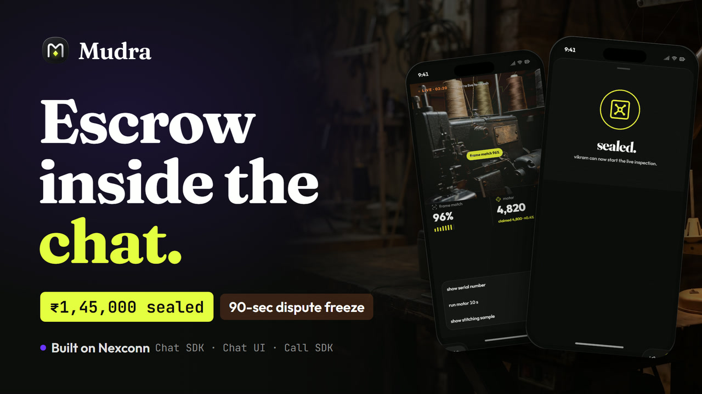

# Mudra (`SamvadDeal`)

**Trust every deal, right in the chat.**

Multilingual escrow, live video inspection and a 90-second dispute freeze, built on the Nexconn Chat SDK, Chat UI and Call SDK.

[](https://github.com/mridulbansal4/Mudra/actions/workflows/ci.yml)
[](LICENSE)


**[Live sandbox (no login)](https://mudra.duckdns.org/sandbox)** · **[Demo video](https://youtu.be/0k8za4bE4bQ)** · **[Live app](https://mudra.duckdns.org)** · **[Animated preview](https://mudra.duckdns.org/demo)** · **[Android APK](https://github.com/mridulbansal4/Mudra/releases/tag/v1.0.0)** · **[Docs](docs/MAP.md)**

<sub>Nexconn Build Challenge 2026 · PS-03 Marketplace & Support · Team Chanakya</sub>

</div>

---

## Try it in two minutes

1. Open the **[live sandbox](https://mudra.duckdns.org/sandbox)**. It provisions a fresh deal with two real Nexconn tokens, connects the browser to Nexconn (header badge: *Nexconn: connected*) and logs every message that arrives over the Nexconn WebSocket.
2. Press **Auto-play 45s demo**: Tamil offer → Hindi reply → escrow lock → video assay (no webcam needed) → dispute freeze, each step with a signed voucher.
3. In the tribunal pane, press **Execute binding split** as the arbitrator.
4. Watch the full walkthrough in the **[demo video](https://youtu.be/0k8za4bE4bQ)**.

## The problem

Rajesh runs a garment workshop in Tirupur and speaks Tamil. Vikram sells refurbished machinery in Ludhiana and speaks Hindi. A ₹1,45,000 overlock machine should be an easy deal, but it breaks in three places:

| Where it breaks | What happens today |
| :--- | :--- |
| **Language** | Copy-paste translation mangles the terms that matter: RPM, warranty, voltage. |
| **Payment trust** | The buyer won't pay a stranger in advance; the seller won't ship on faith. Photos are easy to fake. |
| **Disputes** | When the machine arrives damaged, someone gets blocked and someone files a chargeback. |

## The idea

**The conversation itself becomes the escrow contract, the inspection lab and the courtroom.**

1. **Negotiate in your own language.** Messages are scrubbed for Aadhaar, PAN, phone and UPI IDs by a Rust guard, then translated Tamil ↔ Hindi ↔ English and streamed into custom Nexconn Chat UI cards.
2. **Lock the money, not your trust.** Pay from the Mudra wallet or any UPI app and slide to lock. A Go state machine moves the deal from `CREATED` to `FUNDED`, and an Ed25519-signed voucher lands in the chat.
3. **Inspect it live.** The buyer calls the seller over a 1:1 Nexconn Call SDK video call. Mudra matches the serial plate, fingerprints frames (64-bit pHash) and listens to the motor (4096-point FFT) to confirm the claimed RPM.
4. **Release, or freeze.** The buyer releases funds after verification. If something is wrong, one tap freezes both chats for a 90-second hearing; an arbitrator reviews one evidence packet and an AI tribunal recommendation, then executes a signed split.

---

## Screenshots

<table>
  <tr>
    <td width="50%">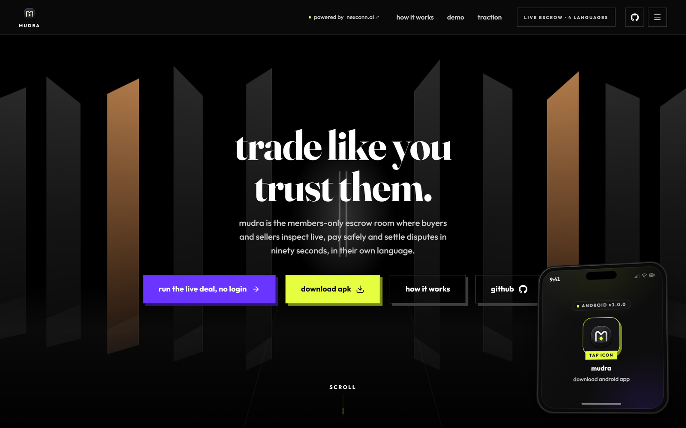<br /><sub><b>Landing</b> · trade like you trust them</sub></td>
    <td width="50%">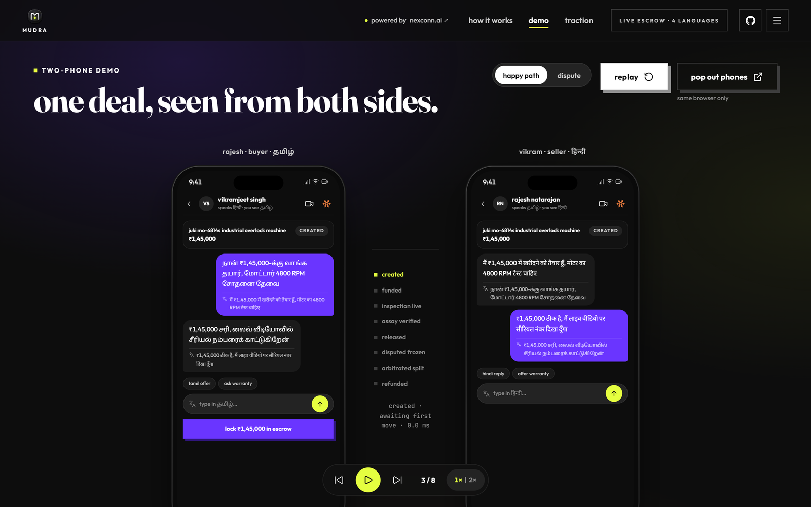<br /><sub><b>Two-phone demo</b> · Tamil offer, Hindi reply, live translation</sub></td>
  </tr>
  <tr>
    <td>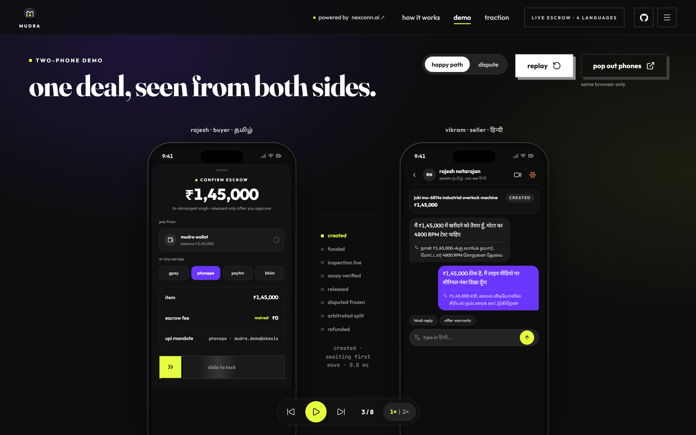<br /><sub><b>Escrow</b> · Mudra wallet or any UPI app, ₹0 fee, slide to lock</sub></td>
    <td>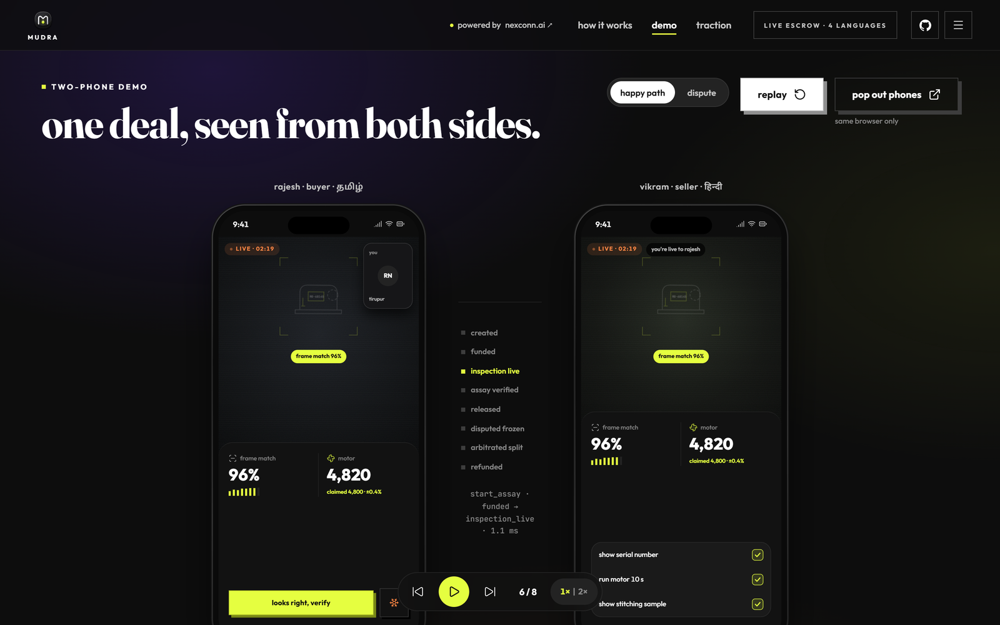<br /><sub><b>Live inspection</b> · 96% frame match, 4,820 RPM motor check</sub></td>
  </tr>
  <tr>
    <td>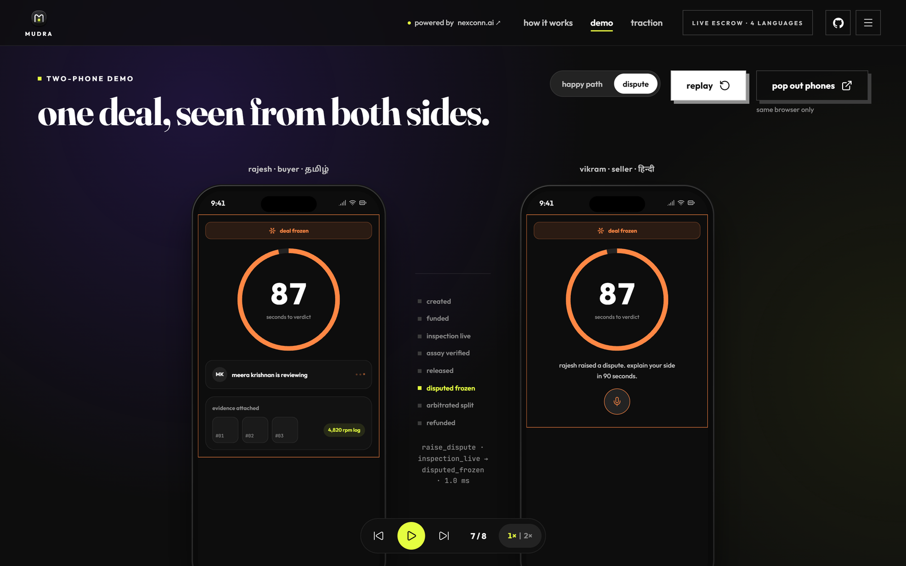<br /><sub><b>Dispute freeze</b> · both chats locked for a 90-second hearing</sub></td>
    <td>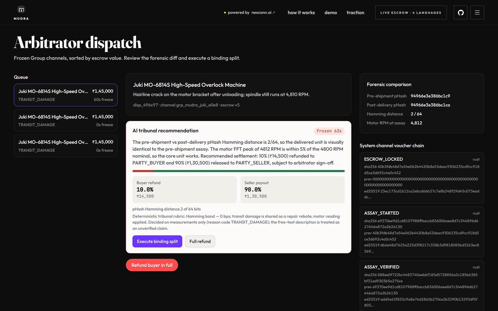<br /><sub><b>Arbitrator dispatch</b> · forensic diff, AI tribunal, signed voucher chain</sub></td>
  </tr>
  <tr>
    <td>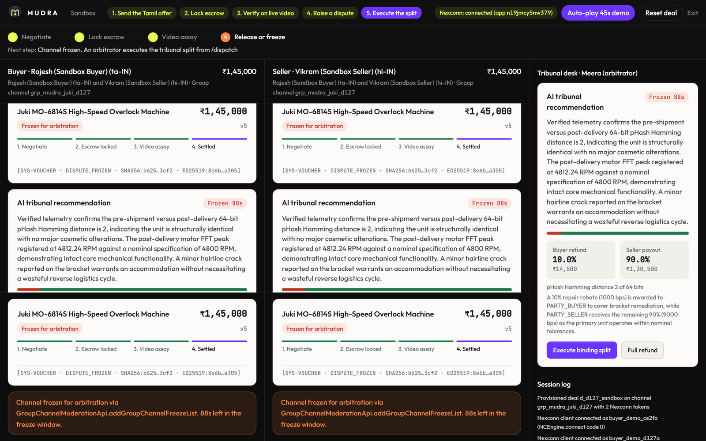<br /><sub><b>Live sandbox</b> · browser connected to Nexconn, every message read back via the Chat SDK</sub></td>
    <td>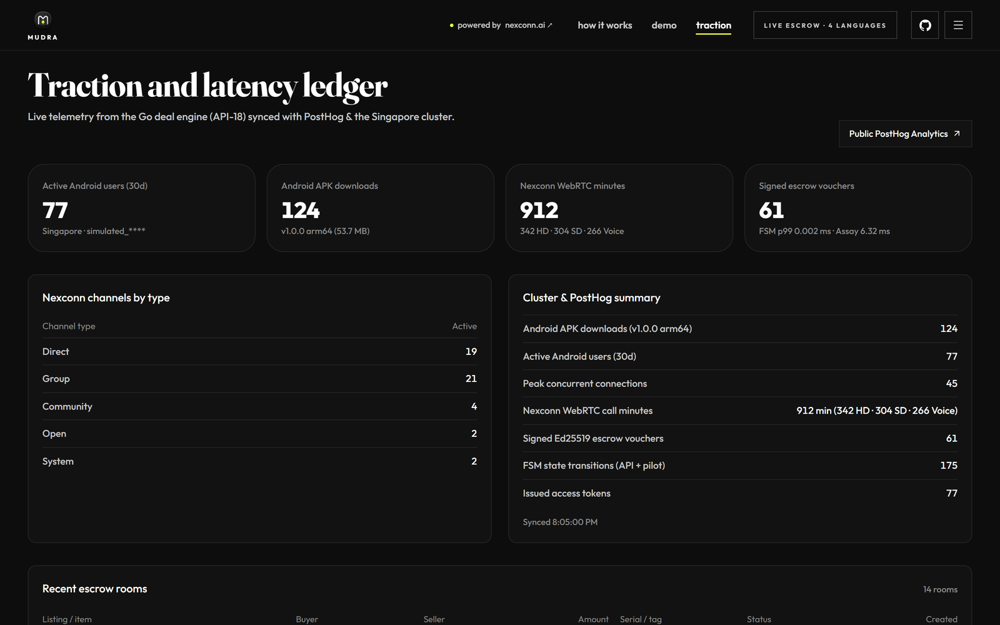<br /><sub><b>Traction</b> · live counters since restart, seeded numbers labelled</sub></td>
  </tr>
  <tr>
    <td>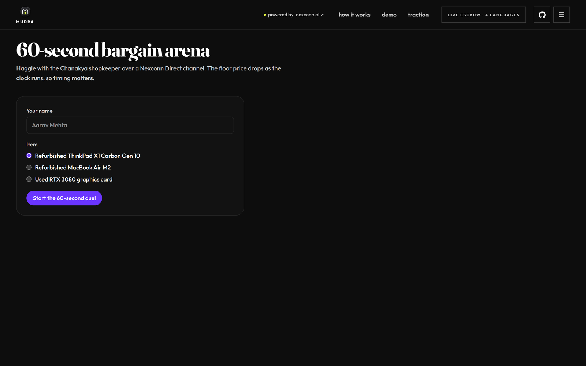<br /><sub><b>Arena</b> · 60-second bargaining duel on a Nexconn direct channel</sub></td>
    <td>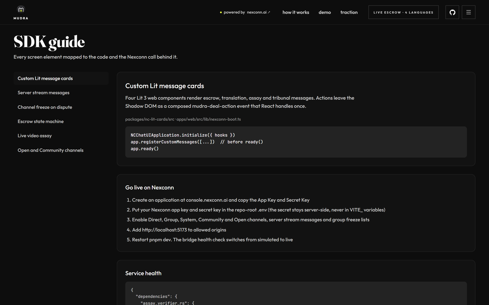<br /><sub><b>SDK guide</b> · every screen mapped to its Nexconn call</sub></td>
  </tr>
</table>

---

## How a deal moves

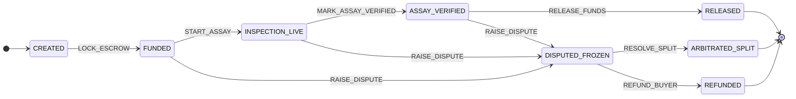

Every transition goes through the Go deal engine with an `Idempotency-Key` and an `expected_version` (optimistic locking), and every milestone writes an Ed25519-signed, hash-chained voucher.

---

## Built on Nexconn

| Nexconn product | Package | How Mudra uses it | Where |
| :--- | :--- | :--- | :--- |
| **Chat SDK** | `@nexconn/chat`, `@nexconn/engine` | `NCEngine.connect` with server-issued tokens; direct, group, community and open channels for deal rooms, flash lots and the arena | [`apps/web/src/lib/nexconn-boot.ts`](apps/web/src/lib/nexconn-boot.ts) |
| **Chat UI** | `@nexconn/chatui` + Lit 3 | Four custom message cards registered before `app.ready()`: `<nc-bilingual-bubble>`, `<nc-escrow-deal-card>`, `<nc-video-assay-receipt>`, `<nc-tribunal-verdict>` | [`packages/nc-lit-cards`](packages/nc-lit-cards) |
| **Call SDK** | `@nexconn/call` | `NCCallEngine.install()` before `NCEngine.initialize`, then a 1:1 audio-video inspection call: the buyer's loupe "Call seller" opens the seller window (`/call/seller`), which auto-answers (`startCall` / `acceptCall` / `endCall`); the received seller video is fingerprinted by Rust. Falls back to the simulated stream without a camera. | [`apps/web/src/lib/nexconn-call.ts`](apps/web/src/lib/nexconn-call.ts), [`apps/web/src/routes/CallSeller.tsx`](apps/web/src/routes/CallSeller.tsx) |
| **Android Chat + Call SDK** | `ai.nexconn.chat:chat` 26.4.2, `ai.nexconn.chat:call` 26.4.1 | The Android APK wraps both official SDKs in a local Expo module: deal chat over a Nexconn Direct channel, and a 1:1 audio-video inspection call from the deal's Inspect screen (`startCall` / `acceptCall` / `endCall`) with an incoming-call sheet on the other phone | [`apps/mobile/modules/nexconn-chat`](apps/mobile/modules/nexconn-chat), [`apps/mobile/src/lib/nexconn.ts`](apps/mobile/src/lib/nexconn.ts) |
| **Server API** | `@nexconn/server-sdk` 0.1.2 (vendored) | `issueAccessToken`, streamed AI messages (`sendGroupChannelStreamMessage`), system vouchers, `addGroupChannelFreezeList` for the dispute freeze | [`services/nexconn-bridge-node/src/nexconn/client.ts`](services/nexconn-bridge-node/src/nexconn/client.ts) |

The Nexconn secret key never leaves `services/nexconn-bridge-node`; CI fails the build if it appears in client code.

---

## Architecture

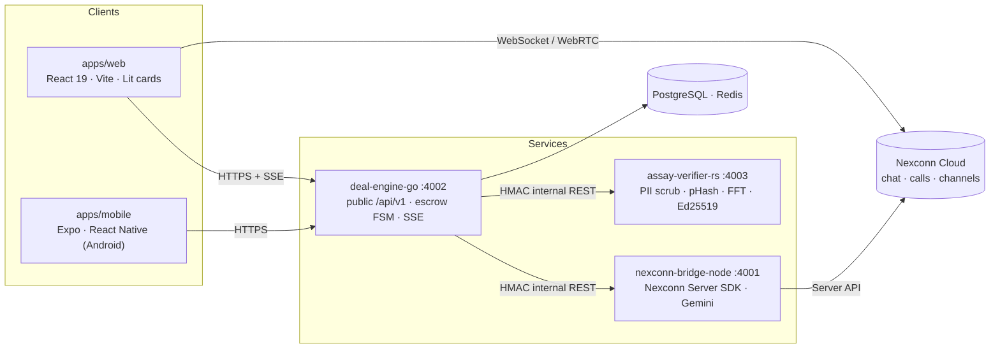

| Service | Language | Responsibilities |
| :--- | :--- | :--- |
| `deal-engine-go` | Go 1.24 (net/http, pgx) | Public API (`/api/v1/*`), 8-state escrow FSM, idempotency, SSE events, traction telemetry |
| `assay-verifier-rs` | Rust 1.85 (axum) | Regex-based DPDP PII scrubbing, 64-bit DCT pHash, 4096-point FFT motor RPM, Ed25519 voucher signing |
| `nexconn-bridge-node` | Node 22 (Fastify) | Vendored Nexconn server SDK host, Gemini translation, tribunal and shopkeeper prompts, rule-based fallbacks |

---

## Repository structure

```text
.
├── apps/
│   ├── web/                    # React 19 web app: landing, /demo, /sandbox, /app, /arena, /dispatch, /traction, /guide
│   └── mobile/                 # Expo / React Native Android companion app: Nexconn Android Chat SDK 26.4.2 for deal chat and Call SDK 26.4.1 for the 1:1 inspection call, Supabase for history and deal state
├── services/
│   ├── deal-engine-go/         # Go public API gateway and escrow state machine (:4002)
│   ├── assay-verifier-rs/      # Rust forensic and crypto engine (:4003)
│   └── nexconn-bridge-node/    # Node bridge to the Nexconn Server SDK and Gemini (:4001)
├── packages/
│   ├── nc-lit-cards/           # Lit custom message cards for Nexconn Chat UI
│   ├── shared-types/           # TypeScript contracts shared by web, bridge and cards
│   └── assay-wasm-rs/          # Browser-side WASM sharpness and pHash helpers
├── ai/prompts/                 # Versioned prompts loaded by the bridge at runtime
├── api/openapi.yaml            # OpenAPI 3.1 contract (API-01..API-18)
├── infra/docker/               # docker-compose for PostgreSQL and Redis
├── scripts/                    # dev launcher, smoke test, model checks
├── docs/                       # Product, design, engineering, AI, ops, security and business docs
└── .github/                    # CI workflows, contributing guide, security policy, templates
```

A full map of every document, with reading orders, is in [`docs/MAP.md`](docs/MAP.md).

---

## Getting started

### Prerequisites

- Node.js `>= 22.12` and pnpm `11`
- Go `>= 1.24`
- Rust `>= 1.85`

### Run everything locally

```bash
cp .env.example .env      # works as-is in simulated mode; add Nexconn + Gemini keys for live mode
pnpm install
pnpm dev
```

`pnpm dev` starts all four processes:

| Process | URL |
| :--- | :--- |
| Web app | http://localhost:5173 |
| Nexconn bridge | http://127.0.0.1:4001 |
| Go deal engine | http://127.0.0.1:4002 |
| Rust assay verifier | http://127.0.0.1:4003 |

With real Nexconn keys the bridge issues live tokens and the sandbox connects the browser to Nexconn. Without real `NEXCONN_APP_KEY` / `NEXCONN_SECRET_KEY` values the bridge runs in **simulated mode**, so the whole flow, including `/demo` and `/sandbox`, works on any machine. If there's no webcam, the app falls back to a simulated HD inspection stream.

### Test

```bash
pnpm typecheck && pnpm test                                   # web, bridge, Lit cards, shared types
cd services/deal-engine-go && go test -race ./...              # Go escrow engine
cd services/assay-verifier-rs && cargo clippy --all-targets -- -D warnings && cargo test
pnpm smoke                                                     # end-to-end smoke test against running services
```

CI runs the same checks on every push: secret scan, Go race tests, Rust fmt + clippy + tests + WASM build, and Node/web typecheck, tests and production build.

---

## Routes

| Route | What it shows |
| :--- | :--- |
| [`/`](https://mudra.duckdns.org) | Landing page, APK download and how Mudra works |
| [`/sandbox`](https://mudra.duckdns.org/sandbox) | Live split-screen deal wired to Nexconn and the real Go, Rust and Node services |
| [`/demo`](https://mudra.duckdns.org/demo) | Animated two-phone preview (scripted, client-side), happy path and dispute branch |
| `/app` | Deal desk with live Chat UI room |
| `/arena` | 60-second AI bargaining duel |
| `/dispatch` | Arbitrator desk: frozen channels, forensic diff, binding split |
| [`/traction`](https://mudra.duckdns.org/traction) | Channel counts, cluster activity and latency |
| `/guide` | SDK guide mapping every screen to its Nexconn call |
| `/how-it-works` | The eight escrow states, step by step |

---

## Documentation

| Area | Start here |
| :--- | :--- |
| Overview | [Project brief](docs/00-overview/PROJECT_BRIEF.md) · [Pitch](docs/00-overview/PITCH.md) · [Vision](docs/00-overview/VISION.md) |
| Product | [PRD](docs/01-product/PRD.md) · [Features](docs/01-product/FEATURES.md) · [Personas](docs/01-product/PERSONAS.md) |
| Engineering | [Architecture](docs/03-engineering/ARCHITECTURE.md) · [Nexconn SDK manual](docs/03-engineering/NEXCONN_SDK_MANUAL.md) · [API spec](docs/03-engineering/API_SPEC.md) · [ADRs](docs/03-engineering/adr) |
| AI | [Models](docs/04-ai/MODELS.md) · [Prompts](docs/04-ai/PROMPTS.md) · [Responsible AI](docs/04-ai/RESPONSIBLE_AI.md) |
| Security | [Security architecture](docs/06-security-compliance/SECURITY_ARCHITECTURE.md) · [Privacy (DPDP)](docs/06-security-compliance/PRIVACY.md) · [Threat model](docs/06-security-compliance/THREAT_MODEL.md) |

---

## What is simulated

- Payments are simulated; no real money moves.
- Inspection video comes over a 1:1 Nexconn call when the seller window has a camera; auto-play and camera-less machines use the simulated HD stream. Either way it is verified by Rust.
- In the sandbox, the post-delivery fingerprint is generated to demonstrate a mismatch.
- `/traction` shows live counters since the last restart; seeded pilot numbers and demo rows are labelled as seeded.

## Contributing

See [CONTRIBUTING.md](.github/CONTRIBUTING.md) for setup, branch naming and the pull-request checklist, and [SECURITY.md](.github/SECURITY.md) to report a vulnerability.

## License

[MIT](LICENSE) © 2026 Team Chanakya
