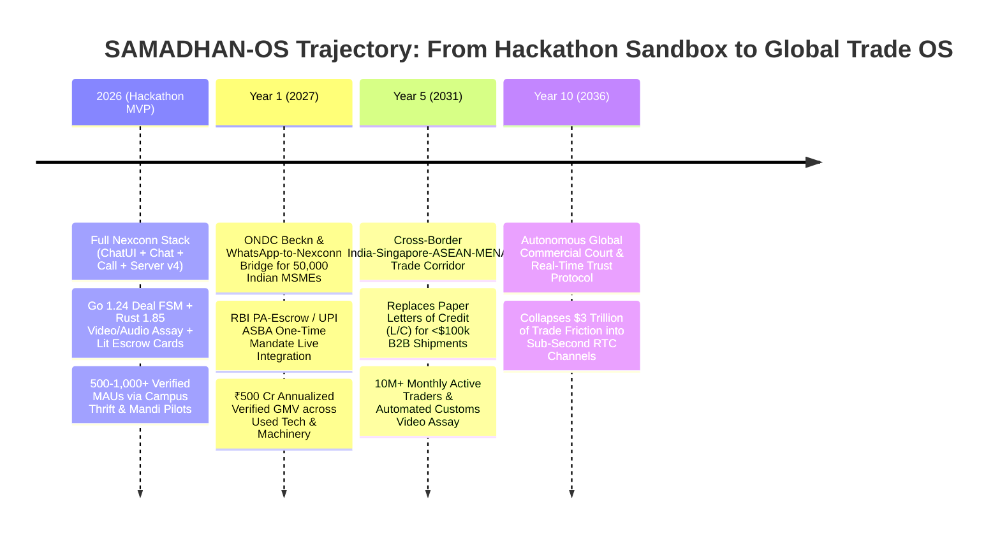

# Vision — SAMADHAN-OS (`SamvadDeal`)
> Project: **SAMADHAN-OS (`SamvadDeal`)** · Owner: Team `Chanakya` (Product & Strategy Lead) · Status: Draft v0.1 · Last updated: 2026-11-10
> Related: [Project Brief](./PROJECT_BRIEF.md) · [Pitch](./PITCH.md) · [PRD](../01-product/PRD.md) · [Impact](../07-business/IMPACT.md)

---

## 1. Vision & Mission Statement

- **Vision**: A world where any two strangers—regardless of spoken language, geography, or institutional size—can negotiate, visually inspect, and settle a high-trust commercial transaction in under three minutes inside a single real-time conversation.
- **Mission**: Transform real-time communication infrastructure (`@nexconn/chatui`, `@nexconn/chat`, `@nexconn/call`, and `@nexconn/server-sdk`) from passive message pipes into **enforceable, cryptographically auditable transactional state machines** that eliminate counterparty fraud across India, ASEAN, and the Global South.

---

## 2. North-Star Metric & Supporting Pillars

- **North-Star Metric**: **Verified Dispute-Free Gross Merchandise Value (`VDF-GMV`) Settled Inside Channels** (measured in `₹ Crore` / `$ USD` where escrow locks (`F-04`), WebRTC video assay (`F-05` + `F-06`), and final settlement (`E-04`) complete without external chargeback or court escalation).
- **Hackathon North-Star Proxy**: **Verified Active Nexconn Deal Participants (`MAUs` in `console.nexconn.ai`) + Completed Split-Screen / Arena Escrow Cycles** (Target: `500–1,000+` verified `userId` connections and `>92%` 90-second dispute resolution rate).

| Pillar | Metric | Hackathon MVP Target | Year 1 Production Target |
|---|---|---|---|
| **Cross-Lingual Speed** | First-token streaming translation latency (`M-01` via `sendGroupChannelStreamMessage`) | `< 280 ms` | `< 150 ms` across 22 Indian + 8 ASEAN languages |
| **Forensic Assay Integrity** | Rust + WASM frame hash + serial plate + audio FFT verification time (`F-06`) | `< 5 ms` (Rust) / `< 900 ms` (Vision) | `< 3 ms` edge WASM + hardware C2PA attestation |
| **Arbitration Velocity** | Median time from `Raise Dispute` (`addGroupChannelFreezeList`) to binding settlement (`F-07`/`F-08`) | `< 90 seconds` | `< 3 minutes` (95% automated + human-in-the-loop) |
| **Zero-Confusion UX** | First-time user completion of `/` → `/auth` → `/onboarding` → `/app` first deal | `> 90%` unassisted | `> 95%` across Web & `heroui-native` Mobile |

---

## 3. The 1-Year / 5-Year / 10-Year Moonshot (Elon Musk First-Principles Trajectory)

### 3.1 Year 1 — The Indian MSME, Refurbished Tech & ONDC Trust Layer
- **Scope**: Deploy across three high-fraud verticals in India: (1) Refurbished Electronics & GPUs/Laptops (`P-03`), (2) Inter-State B2B Industrial Machinery & Textile Lots (`P-01`, `P-02`), and (3) Agricultural FPO Wholesale Mandis.
- **Scale**: 50,000+ active merchants, ₹500 Crore in video-verified escrow volume, native integration with ONDC IGM (Issue & Grievance Management) and UPI ASBA blocked-funds mandates.

### 3.2 Year 5 — The India–Singapore–ASEAN Cross-Border Trade Desk
- **Scope**: Leveraging **RCLOUD GLOBAL PTE. LTD.**'s Singapore presence and Southeast Asian edge network, expand SAMADHAN-OS into the default bilateral deal room for India–Singapore–Vietnam–Indonesia cross-border SME trade.
- **Scale**: Replace 14-day bank Letters of Credit (L/C) for shipments under $100,000 USD with live factory-floor `@nexconn/call` video assays, Rust-signed bills of lading in `System` channels, and instant multi-currency escrow settlement.

### 3.3 Year 10 — First-Principles Collapse of Commercial Litigation
- **First-Principles Insight**: Commercial courts and Letters of Credit exist only because historically, buyers and sellers could not simultaneously see the physical goods, understand each other's language, and lock programmable money in real time.
- **The 10-Year Picture**: SAMADHAN-OS becomes the global TCP/IP of commercial trust—an autonomous real-time trade protocol where $3 Trillion of global B2B and P2P commerce is negotiated across 100+ languages, verified by multimodal AI + robotic/camera telemetry over WebRTC, and arbitrated in 90 seconds.

---

## 4. Core Architectural & Philosophical Principles

Grounded in our Sacred Texts Metacognitive Matrix (`state.md`) and Design Skills (`/hallmark`, `/unslop`, `/apple-design`):

1. **Non-Dual Protocol Unity (*Ashtavakra Mahageeta — Nirvikalpa*)**: Do not separate conversation from contract. The `<nc-escrow-deal-card>` lives *inside* the `<nc-chat-ui-app-provider>` message stream; the `@nexconn/call` video inspection rides *over* the `NCEngine` socket; the audit receipt lands *in* the `System` channel.
2. **Surgical Engineering Speed (*Hanuman Chalisa — Laghima & Garima*)**: Zero bloated Python layers in the critical path. **Go 1.24** handles deterministic escrow state transitions in `<1.2ms`; **Rust 1.85 + WASM** handles perceptual frame hashing, audio FFT motor diagnostics, PII scrubbing, and Ed25519 cryptographic signing in `<5ms`; **Node.js 22** drives the official `@nexconn/server-sdk`.
3. **Beginner-First Story Clarity (*Jony Ive & Don Norman*)**: A first-time user or an exhausted hackathon judge at 2 AM must never ask *"Where do I click?"*. Every route (`/` → `/auth` → `/onboarding` → `/app` → `/sandbox`) reads like a clear story with a persistent 4-stage progress bar and contextual coachmarks.
4. **Enforceable Deterrence (*Chanakya Arthashastra — Sama, Dana, Bheda, Danda*)**:
   - *Sama* (Conciliation): Real-time cross-lingual translation (`F-03`).
   - *Dana* (Incentive): Instant escrow milestone release (`F-04`) and zero-login guest tokens (`F-01`).
   - *Bheda* (Forensic Discrimination): Rust + Vision frame/audio defect comparison (`F-06`).
   - *Danda* (Enforcement): Instant `addGroupChannelFreezeList` room lock (`F-07`) + binding AI/Human Tribunal (`F-08`).

---

## 5. Why Now (2025–2026 Inflection Point)

1. **Generative Photo Fraud Has Broken Static Marketplaces**: In 2025–2026, anyone can generate a fake damaged product photo or edit a serial number plate in 5 seconds. Static image uploads are dead as proof; **live interactive challenge-response WebRTC video (`@nexconn/call`) + Rust WASM frame hashing** is the only viable defense ([arXiv:2402.18679](https://arxiv.org/abs/2402.18679)).
2. **Nexconn's 2026 Unified SDK Release**: The simultaneous availability of `@nexconn/chatui@^26.2.5` (Lit custom components), `@nexconn/chat@^26.2.1` (5 channel types), `@nexconn/call@^26.2.0` (`requestChangeMediaType`), and `@nexconn/server-sdk@0.1.2` (`sendGroupChannelStreamMessage` + `addGroupChannelFreezeList`) makes it possible to build a unified chat + video + streaming AI + moderation freeze state machine without stitching together four incompatible vendors.
3. **India DPI + Cross-Border MSME Boom**: ONDC B2B trade, UPI ASBA blocked mandates, and Bhashini Indic models have matured just as Indian MSMEs and thrift sellers demand safe conversational commerce ([ONDC](https://ondc.org), [Bhashini](https://bhashini.gov.in)).

---

## 6. Impact Thesis

By eliminating the **35% middleman trust tax** in inter-state FPO/MSME trade and preventing **₹38,000+ Crore** in P2P and B2B advance-payment scams, SAMADHAN-OS directly empowers small manufacturers (`P-01`), regional machinery dealers (`P-02`), student micro-entrepreneurs (`P-03`), and vernacular farmers to trade with national and international counterparties on equal footing.
