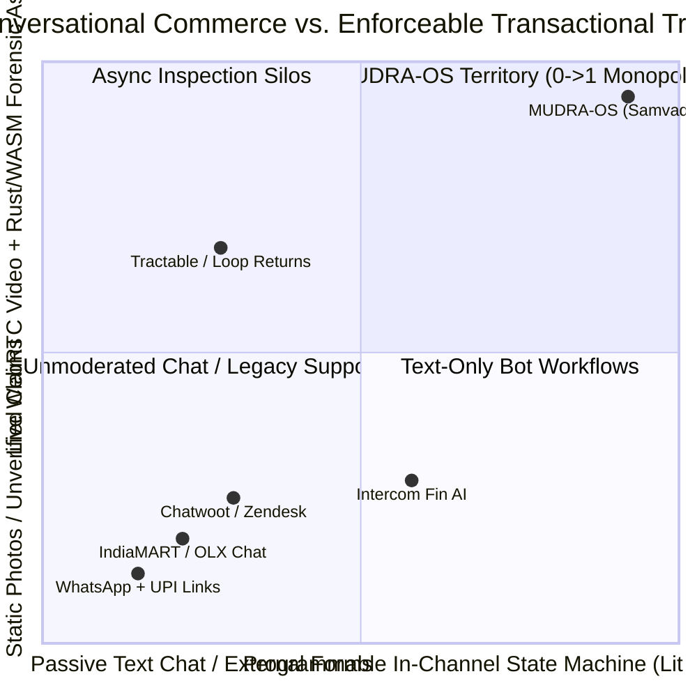

# Competitive Analysis & Moat - MUDRA-OS (`SamvadDeal`)
> Project: **MUDRA-OS (`SamvadDeal`)** · Owner: Team `Chanakya` (Strategy & Market Intelligence Lead - Peter Thiel Chair) · Status: Draft v0.1 · Last updated: 2026-11-10
> Related: [Project Brief](../00-overview/PROJECT_BRIEF.md) · [PRD](./PRD.md) · [Business Model](../07-business/BUSINESS_MODEL.md) · [Pitch](../00-overview/PITCH.md)

---

## 1. Comprehensive Competitor Matrix (India + Global)

| Competitor / Repo | Category & Funding | Core Product Offering | Pricing | Critical Gaps That MUDRA-OS Solves |
|---|---|---|---|---|
| **Intercom (Fin AI)** ([intercom.com](https://www.intercom.com)) | Global Enterprise Support SaaS ($240M+ raised, $300M+ ARR) | Customer support widget + AI helpdesk chatbot + agent routing | `$39–$139/seat/mo` + `$0.99/Fin resolution` | **1-to-Many Support Only**: Built for a company answering support tickets - zero bilateral buyer-seller 1:1 negotiation, zero custom Lit escrow cards, zero live WebRTC video product assay, zero channel-freeze arbitration. |
| **Chatwoot (YC W21)** ([github.com/chatwoot/chatwoot](https://github.com/chatwoot/chatwoot)) | Open-Source / India-rooted SaaS (`21k+` GitHub ★, $1.5M+ seed) | Omnichannel customer support inbox over WhatsApp/Email/Web | Free self-hosted / `$19–$99/agent/mo` | **No Programmable Deal State**: Plain text/attachment inbox; cannot lock a group room via `addGroupChannelFreezeList`, cannot stream live translations token-by-token into custom Lit components, and lacks native WebRTC defect verification. |
| **WhatsApp Business + Bikayi (YC S20)** ([ycombinator.com/companies/bikayi](https://www.ycombinator.com/companies/bikayi)) | Indian SMB Conversational Commerce ($10.8M Series A) | WhatsApp catalog sharing + external payment links | `₹999–₹4,999/mo` | **The Scam Ground Zero**: No in-bubble Tamil ↔ Hindi streaming translation, no live challenge-response video serial check (static forwarded videos are easily faked), and sellers can block buyers the second UPI clears. |
| **IndiaMART / OLX / e-NAM** ([indiamart.com](https://www.indiamart.com), [enam.gov.in](https://enam.gov.in)) | B2B / P2P / Agri Directories (Public / Government) | Lead discovery directories & static bidding boards | Lead subscription (`₹3,000+/mo`) | **Drops Users at the Precipice**: Once a buyer clicks "Contact Seller," they are dumped onto unmoderated phone calls or WhatsApp with zero escrow state machine, zero live video assay, and zero 90-second dispute tribunal. |
| **Tractable / Loop Returns** ([tractable.ai](https://tractable.ai), [loopreturns.com](https://www.loopreturns.com)) | AI Claims & Returns Automation ($185M+ / $115M+ raised) | Asynchronous photo upload damage estimation & return label portals | Enterprise annual contracts (`$50k+/yr`) | **Vulnerable to 2026 Deepfakes**: Relies on static uploaded photos that are trivially manipulated by generative AI; lacks a unified real-time chat + live WebRTC tele-inspection room. |
| **Sendbird / Stream Default Demos** ([sendbird.com](https://sendbird.com), [getstream.io](https://getstream.io)) | Legacy Comms PaaS Competitors to Nexconn | Raw chat UI kits and basic moderation hooks | `$399–$1,299+/mo` | **Lack Unified v4 Server Streaming + Polyglot Assay**: Neither ships an integrated Go FSM + Rust/WASM video/audio forensic assay + Lit `<nc-escrow-deal-card>` + native server-streamed AI Tribunal out of the box. |

---

## 2. 2x2 Positioning Map

---

## 3. Our Structural Moat (Peter Thiel & Warren Buffett Analysis)

Why can't an incumbent support tool (Intercom/Chatwoot) or a generic hackathon team replicate MUDRA-OS quickly?

1. **Protocol-Level State Machine Fusion (`@nexconn/chatui` + Go 1.24 FSM + `SystemMessagesApi`)**:
   - Adding escrow to a normal chat app usually means pasting an external Stripe/Razorpay link that opens in another tab. In MUDRA-OS, the `<nc-escrow-deal-card>` Lit Web Component is the **single source of UI state**, backed by a serializable Go 1.24 FSM (`services/deal-engine-go`) and hash-chained `System` channel vouchers (`E-08`).
2. **Real-Time Multimodal Forensics Over WebRTC (`@nexconn/call` + Rust 1.85 + WASM)**:
   - Combining `@nexconn/call`'s `requestChangeMediaType(NCCallMediaType.VIDEO)` and `onServerCallLogReceived` with a 60fps browser WebAssembly module (`packages/assay-wasm-rs`) and a `<5ms` Rust server verifier (`pHash` + 4096-point `rustfft` motor/fan acoustic analysis + Ed25519 signature) creates an unforgeable physical proof layer that text-only chatbots cannot touch.
3. **Deterministic Dispute Freeze (`addGroupChannelFreezeList` + `sendGroupChannelStreamMessage`)**:
   - The moment a dispute is triggered, `GroupChannelModerationApi.addGroupChannelFreezeList` freezes the room at the Nexconn server layer so neither party can tamper with evidence, while `M-04` streams a binding settlement split into `<nc-tribunal-verdict-card>`.
4. **Bilateral Viral Network Effects**:
   - Every seller (`P-02`) who uses MUDRA-OS to protect against COD return fraud pulls in 20+ out-of-state buyers (`P-01`), and every buyer who demands a video-escrow link pulls in new sellers - compounding verified MAUs on `console.nexconn.ai` with near-zero CAC.
