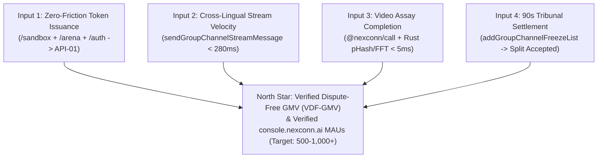

# Product Metrics, Funnel & Event Taxonomy — SAMADHAN-OS (`SamvadDeal`)
> Project: **SAMADHAN-OS (`SamvadDeal`)** · Owner: Team `Chanakya` (Growth, Telemetry & Analytics Lead) · Status: Draft v0.1 · Last updated: 2026-11-10
> Related: [Project Brief](../00-overview/PROJECT_BRIEF.md) · [PRD](./PRD.md) · [Observability](../05-ops/OBSERVABILITY.md) · [GTM](../07-business/GTM.md)

---

## 1. North-Star Metric & Hierarchy

- **Production North-Star Metric**: **Verified Dispute-Free Gross Merchandise Value (`VDF-GMV`)** — Total value (`₹` / `$`) of transactions where escrow is locked in `<nc-escrow-deal-card>`, verified over live `@nexconn/call` video + Rust WASM assay, and settled without external chargeback.
- **Hackathon Judging North-Star Metric (Weight: 15% Traction + 25% SDK Integration)**: **Verified Unique Nexconn Active Users (`MAUs` in `console.nexconn.ai`) + Full-Cycle SDK Funnel Completion Rate**.

---

## 2. AARRR Pirate Funnel Metrics (Hackathon MVP & Production Targets)

| Stage | Definition in SAMADHAN-OS | Primary Route / Trigger | Hackathon MVP Target (Nov 23, 2026) | v1 Production Target (Q2 2027) |
|---|---|---|---|---|
| **Acquisition** | Unique visitors landing on `/`, `/sandbox`, `/arena`, or shared deal room links | Campus WhatsApp groups, `r/IndianGaming`, local refurb shops, Judge Card | `1,500+` unique visitors | `120,000 / mo` |
| **Activation** | Visitor receives a real Nexconn token (`issueAccessToken`) and completes `await NCEngine.connect({ token })` | `/auth` (1-Tap), `/sandbox` (Auto-Dual), `/arena` (Auto-Player) | `> 65%` (`500 – 1,000+` verified Nexconn MAUs) | `> 55%` (`66,000 MAUs`) |
| **Retention** | User completes at least 1 full 4-Stage Deal Story cycle or plays `>= 2` `/arena` bargaining rounds | `/app`, `/sandbox`, `/arena` | `> 48%` multi-session / multi-action rate | `> 42%` D30 merchant retention |
| **Referral** | User shares a `/arena` score card or invites a counterparty to a live deal room (spawning a new Nexconn `userId`) | WhatsApp Share CTA on `/arena` & `/app` | Viral K-factor `>= 1.35` in campus groups | K-factor `>= 0.65` in B2B trade |
| **Revenue** | Escrow contracts locked (`LOCKED`) and settled (`SETTLED_RELEASED` / `SETTLED_SPLIT`) at `0.8%` take rate | `<nc-escrow-deal-card>` (`API-06`, `API-11`) | `300+` completed sandbox/pilot escrow cycles | `₹40 Cr / mo` GMV (`₹32L / mo` net rev) |

---

## 3. Canonical Analytics Event Taxonomy

Tracked in dual-write mode: (1) Internal PostgreSQL + Go telemetry ledger (`API-18` powering `/traction` with zero ad-blocker drop-off) and (2) PostHog Cloud (DPDP-compliant, zero PII).

| Event Name | Trigger Point | Required Properties (JSON Schema) | Nexconn SDK / Backend Correlation |
|---|---|---|---|
| `story_landing_viewed` | User loads `/` | `{ viewport: "1280x800", referrer: string, theme: "light"\|"dark" }` | Pre-connection |
| `story_cta_pressed` | User clicks Primary (`1-Click Sandbox`) or Secondary (`Sign In`) CTA on `/` | `{ target_route: "/sandbox"\|"/auth"\|"/arena", cta_variant: string }` | Pre-connection |
| `nexconn_session_connected` | `await NCEngine.connect({ token })` resolves | `{ nexconn_user_id: string, role: "buyer"\|"seller"\|"arbitrator"\|"guest", latency_ms: number }` | `UserManagementApi.issueAccessToken` + `NCEngine.connect` (**Counts as 1 Verified MAU**) |
| `onboarding_completed` | User finishes 3-step `/onboarding` wizard | `{ source_lang: string, target_lang: string, camera_mode: "webcam"\|"simulated_hd" }` | Configures `<nc-bilingual-bubble>` & `NCCallEngine` source |
| `bilingual_stream_completed` | `sendGroupChannelStreamMessage` finishes streaming into `<nc-bilingual-bubble>` | `{ deal_id: string, channel_id: string, src_lang: string, tgt_lang: string, ttft_ms: number, pii_scrub_us: number }` | `MessageManagementApi.sendGroupChannelStreamMessage` (`API-05`) |
| `escrow_card_transitioned` | User clicks action inside `<nc-escrow-deal-card>` | `{ deal_id: string, prev_state: string, next_state: string, amount_paise: number, go_fsm_us: number }` | `registerMessageType` (`x-samadhan-escrow-card`) + Go FSM (`API-06`) |
| `video_assay_started` | User clicks `Verify on Live Video` | `{ deal_id: string, call_id: string, media_type: "VIDEO", camera_mode: "webcam"\|"simulated_hd" }` | `NCCallEngine.startCall` + `requestChangeMediaType(NCCallMediaType.VIDEO)` |
| `video_assay_verified` | Rust `assay-verifier-rs` signs frame + audio FFT receipt | `{ deal_id: string, call_id: string, phash_hex: string, rpm_peak_hz: number, rust_exec_ms: number, vision_pass: boolean }` | `onServerCallLogReceived` + `SystemMessagesApi` (`API-08`) |
| `dispute_channel_frozen` | User clicks `Raise Dispute` | `{ deal_id: string, channel_id: string, freeze_latency_ms: number, reason_code: string }` | `GroupChannelModerationApi.addGroupChannelFreezeList` (`API-09`) |
| `tribunal_split_settled` | Arbitrator or parties accept `<nc-tribunal-verdict-card>` split | `{ dispute_id: string, buyer_refund_bps: number, seller_payout_bps: number, total_resolution_sec: number }` | `sendGroupChannelStreamMessage` + `SystemMessagesApi` (`API-11`) |
| `open_lot_broadcasted` | Verified seller posts flash lot to `Open` ticker | `{ lot_id: string, open_channel_id: string, community_subchannel_id: string }` | `OpenChannelPriorityControlsApi` + `createCommunitySubchannel` (`API-13`/`API-14`) |
| `arena_bargain_completed` | Player finishes 60s `/arena` challenge | `{ run_id: string, nexconn_user_id: string, discount_pct: number, shared_whatsapp: boolean }` | `MessageManagementApi.sendDirectChannelStreamMessage` (`API-15`/`API-16`) |

---

## 4. Public & Internal Dashboards

1. **Public Judge & User Traction Dashboard (`/traction` route in `apps/web`)**:
   - Powered by `GET /api/v1/traction/telemetry` (`API-18`).
   - Displays 4 clean Unslop/Hallmark stat cards (`tabular-nums`):
     - **Verified Nexconn Active Users (MAU)**: Live count + 24h delta matching `console.nexconn.ai`.
     - **Active Channels by Type**: Breakdown across `Direct`, `Group`, `System`, `Open`, and `Community`.
     - **Forensic Video Assays & Frozen Tribunals**: Count of `onServerCallLogReceived` receipts and `<90s` settled disputes.
     - **Systems Latency Histogram**: Live p50/p95 for Go FSM (`<1.2ms`), Rust `pHash`/PII scrub (`<5ms` / `<300µs`), and Nexconn stream TTFT (`<280ms`).
2. **Nexconn Official Developer Console (`https://console.nexconn.ai`)**:
   - Accessible to judges via the 1-click `Copy` (`Ke`) button next to our `App Key` on `AdminParts-DCOz_uK5.js`.
