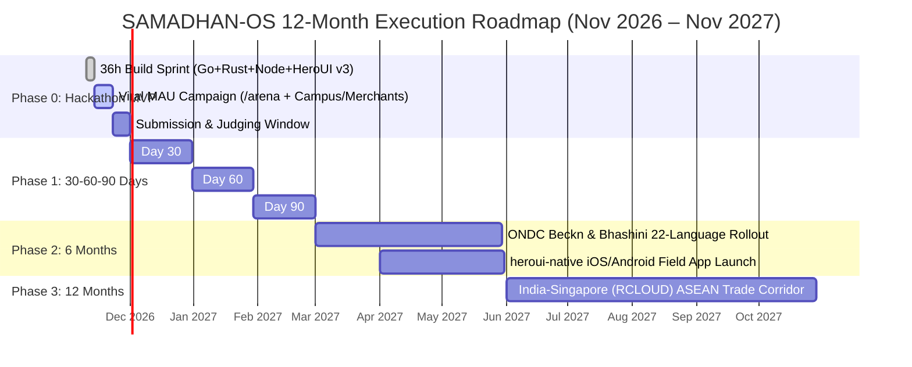

# Product Roadmap — SAMADHAN-OS (`SamvadDeal`)
> Project: **SAMADHAN-OS (`SamvadDeal`)** · Owner: Team `Chanakya` (Product Strategy Lead) · Status: Draft v0.1 · Last updated: 2026-11-10
> Related: [Project Brief](../00-overview/PROJECT_BRIEF.md) · [Vision](../00-overview/VISION.md) · [PRD](./PRD.md) · [GTM](../07-business/GTM.md)

---

## 1. Roadmap Overview: Hackathon Sprint to Global Trade OS

---

## 2. Phase-by-Phase Milestones & Deliverables

### Phase 0: Hackathon MVP & Viral MAU Validation (Oct 23 – Nov 23, 2026)
- **Engineering Deliverables**:
  - Complete 9-route Story Frontend (`/` → `/auth` → `/onboarding` → `/app` → `/sandbox` → `/arena` → `/dispatch` → `/guide` → `/traction`) built with React 19, Tailwind v4, HeroUI v3 (`@heroui/react@^3.0.1`), `/hallmark` Floor, `/unslop` tokens, and `/apple-design` springs.
  - Full integration of `@nexconn/chatui@^26.2.5` (`<nc-chat-ui-app-provider>` + 4 Lit `BaseMessageContent` cards), `@nexconn/chat@^26.2.1` (`NCEngine` `Open` & `Community` channels), `@nexconn/call@^26.2.0` (`NCCallEngine` video escalation + `onServerCallLogReceived`), and `@nexconn/server-sdk@0.1.2` (`issueAccessToken`, `sendDirectChannelStreamMessage`, `sendGroupChannelStreamMessage`, `addGroupChannelFreezeList`, `OpenChannelPriorityControlsApi`, `SystemMessagesApi`).
  - Polyglot backend: **Go 1.24** (`services/deal-engine-go`), **Rust 1.85 + WASM** (`services/assay-verifier-rs` & `packages/assay-wasm-rs`), and **Node.js 22** (`services/nexconn-bridge-node`).
- **Traction Target**: `500–1,000+` verified connected unique `userId`s (MAUs) in `console.nexconn.ai` via `/arena` campus WhatsApp challenges and refurbished electronics shop trials.

---

### Phase 1: Post-Hackathon 30 / 60 / 90-Day Plan (Dec 2026 – Feb 2027)

| Milestone | Target Date | Core Engineering & Product Scope | Pilot Partners & KPIs |
|---|---|---|---|
| **Day 30: P2P Electronics & Campus Thrift Launch** | Dec 31, 2026 | Ship browser screen-share stress-test presets (FurMark GPU benchmark & MacBook battery cycle OCR inside `packages/assay-wasm-rs`); add WhatsApp bot deep-link generator (`samadhan.os/d/<slug>`). | **Partners**: 15 college hostel buy/sell communities + `r/IndianGaming` hardware swap moderators. **KPI**: `5,000 MAUs`, `₹1.2 Cr` verified P2P escrow volume. |
| **Day 60: Live RBI PA-Escrow & UPI ASBA Integration** | Jan 30, 2027 | Upgrade `API-17` (`services/deal-engine-go`) from sandbox HMAC webhooks to live production **Razorpay Route / Cashfree Escrow** (backed by Yes Bank / Axis Bank nodal escrow accounts) + NPCI **UPI One-Time Mandate (ASBA)**. | **Partners**: 40 refurbished laptop/phone dealers in Bengaluru (SP Road), Mumbai (Lamington Road), and Delhi (Nehru Place). **KPI**: `12,000 MAUs`, `₹8.5 Cr` GMV, `<0.2%` fraud loss. |
| **Day 90: Inter-State B2B Machinery & Textile Corridor** | Feb 28, 2027 | Add multi-milestone B2B escrow (`30% Booking` → `40% Live Video Assay` → `30% Delivery Assay`) in `<nc-escrow-deal-card>` + Rust `rustfft` acoustic presets for industrial sewing/CNC spindles. | **Partners**: Tirupur Exporters' Association (TEA) MSME buyers (`P-01`) & Ludhiana machinery dealers (`P-02`). **KPI**: `250 B2B merchants`, `₹25 Cr` annualized GMV. |

---

### Phase 2: 6-Month Expansion (Mar – May 2027) — ONDC & Mobile Field Scale
1. **ONDC Beckn Protocol Adapter (`services/deal-engine-go`)**:
   - Publish SAMADHAN-OS as an open **ONDC Pre-Shipment Assay & Issue/Grievance Management (IGM 2.0) TSP**, allowing any ONDC Buyer App or Seller App to spawn a Nexconn video-escrow room on high-value B2B orders.
2. **Full 22-Language Bhashini Pipeline + `heroui-native` Mobile App**:
   - Release `apps/mobile-expo` (`heroui-native@^2.0.1` + Uniwind) on Google Play and iOS App Store with offline frame queuing and full 22-language Bhashini voice-to-voice translation for agricultural FPO mandis (`e-NAM` sellers).
3. **6-Month KPI Target**: `30,000+ MAUs` (fully utilizing the 2-Year Free Nexconn Chat Plan prize!), `₹180 Cr` annualized GMV, `96.5%` dispute resolution under 3 minutes.

---

### Phase 3: 12-Month Vision (Jun – Nov 2027) — The India–Singapore–ASEAN Corridor
1. **Cross-Border Singapore–India Trade Desk (Aligned with RCLOUD GLOBAL PTE. LTD.)**:
   - Integrate **UPI–PayNow** cross-border instant settlement and Singapore MAS-compliant escrow rails so Singaporean importers and ASEAN SMEs can inspect and purchase Indian textiles, spices, and engineering components inside SAMADHAN-OS.
2. **Hardware C2PA & IoT Telemetry Attestation**:
   - Integrate C2PA cryptographic camera signatures and Bluetooth OBD-II / moisture meter telemetry directly into `services/assay-verifier-rs`.
3. **12-Month KPI Target**: `100,000+ MAUs`, `₹650+ Crore ($78M USD)` verified GMV, Series Seed/A readiness alongside Nexconn AI's global enterprise sales team.
