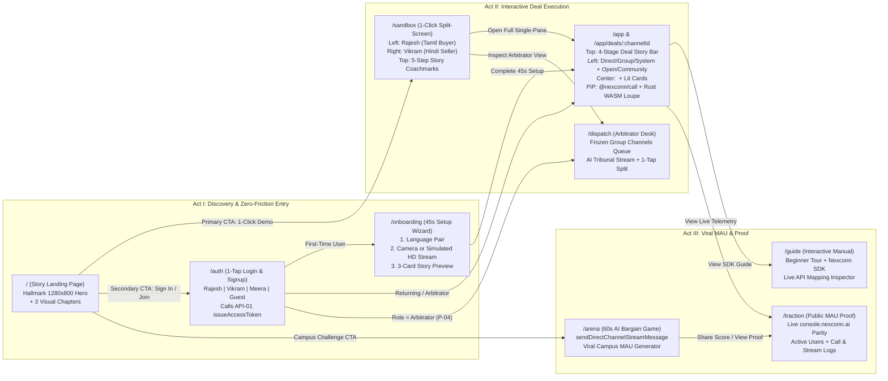
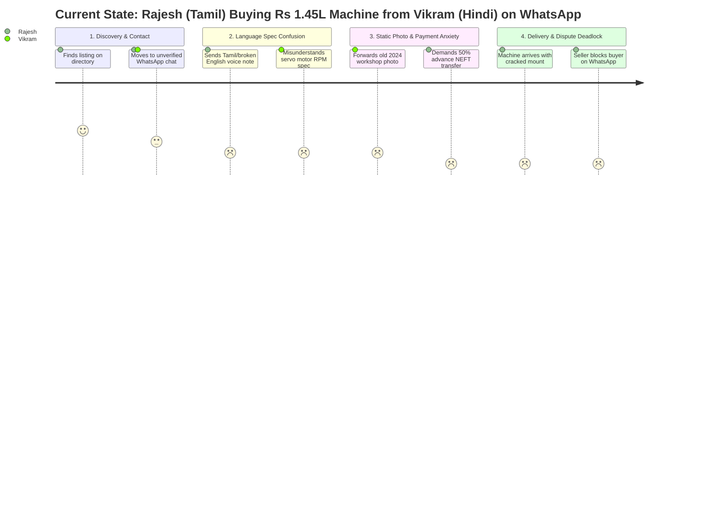

# User Journeys & Story Flows — SAMADHAN-OS (`SamvadDeal`)
> Project: **SAMADHAN-OS (`SamvadDeal`)** · Owner: Team `Chanakya` (UX & Product Flow Lead) · Status: Draft v0.1 · Last updated: 2026-11-10
> Related: [Project Brief](../00-overview/PROJECT_BRIEF.md) · [PRD](./PRD.md) · [Personas](./PERSONAS.md) · [UI Spec](../02-design/UI_SPEC.md) · [Frontend Architecture](../03-engineering/FRONTEND.md)

---

## 1. End-to-End Frontend Story Routing Architecture (Beginner & Judge First)

Per product mandate, SAMADHAN-OS never drops a first-time user or judge into an unguided screen. Every visitor moves through a deliberate, progressive **Story Flow**:



---

## 2. Journey 1: Cross-Lingual B2B Machinery Purchase (`P-01` Rajesh ↔ `P-02` Vikram)

### 2.1 Current-State Journey (Broken WhatsApp + NEFT Status Quo)


### 2.2 Future-State Journey on SAMADHAN-OS (`SamvadDeal`)
```mermaid
journey
    title Future State: Rajesh & Vikram on SAMADHAN-OS (3-Minute Verified Deal)
    section 1. Story Onboarding (45s)
      Opens / and clicks Sign In (/auth): 5: Rajesh
      Selects Tamil in /onboarding wizard: 5: Rajesh
    section 2. Stage 1: Bilingual Negotiation
      Speaks/types in Tamil in Deal Room: 5: Rajesh
      Reads live streamed Hindi + JSON terms (<280ms): 5: Vikram
    section 3. Stage 2: Lit Escrow Lock
      Clicks Lock Rs 1,45,000 in <nc-escrow-deal-card>: 5: Rajesh, Vikram
      Receives Ed25519 receipt in System channel: 5: Rajesh, Vikram
    section 4. Stage 3: Live WebRTC Video Assay
      Clicks Verify on Video (@nexconn/call): 5: Rajesh
      Shows running machine; Rust WASM locks serial & 4820 RPM: 5: Vikram
    section 5. Stage 4: 90s Freeze Tribunal
      Flags minor transit mount crack -> Raise Dispute: 4: Rajesh
      Channel freezes (<150ms); AI + Meera stream 88/12 split: 5: Rajesh, Vikram, Meera
```

### 2.3 Moments of Truth & Emotional Curve (`P-01` & `P-02`)
1. **Moment of Truth #1 (Second `0:15` — The First Translated Bubble)**: When Rajesh speaks in Tamil and watches `<nc-bilingual-bubble>` stream fluent Hindi + extracted JSON chips (`Price: ₹1,45,000`, `Warranty: 6 Months`, `Assay: 4,800 RPM Test`) onto Vikram's screen in `260ms` via `sendGroupChannelStreamMessage`. *Emotion shifts from linguistic anxiety to instant clarity.*
2. **Moment of Truth #2 (Second `0:45` — The Rust WASM Green Bounding Box)**: During the `@nexconn/call` HD video inspection, when the Apple-design PiP Loupe locks onto serial plate `JUKI-MO-6814S-8821` with aVault Emerald (`oklch(0.58 0.16 155)`) bounding box and logs `onServerCallLogReceived`. *Emotion shifts from scam paranoia to forensic certainty.*
3. **Moment of Truth #3 (Second `1:30` — The 110ms Vermilion Freeze Seal)**: When `Raise Dispute` invokes `addGroupChannelFreezeList`, halting emotional arguments and streaming an objective `88% / 12%` repair rebate in 90 seconds. *Emotion shifts from helplessness to institutional protection.*

---

## 3. Journey 2: Solo Judge at 2 AM (`P-05`) — Zero-Cold-Start 60-Second Walkthrough

```mermaid
sequenceDiagram
    autonumber
    actor Judge as P-05: Hackathon Judge (2 AM)
    participant Web as apps/web (/ -> /sandbox)
    participant Go as deal-engine-go (:4002)
    participant Node as nexconn-bridge-node (:4001)
    participant NC as Nexconn Cloud (api.nexconn.ai)
    participant Rust as assay-verifier-rs (:4003)

    Judge->>Web: Opens Live App URL (/) -> Clicks "Launch 1-Click Split-Screen Live Demo"
    Web->>Go: POST /api/v1/sandbox/provision (API-02)
    Go->>Node: Request dual Buyer + Seller tokens & seeded Group channel
    Node->>NC: UserManagementApi.issueAccessToken (buyer_demo_X & seller_demo_X)
    Node->>NC: GroupChannelManagementApi.createGroupChannel
    NC-->>Web: Connect Left Pane (Buyer) & Right Pane (Seller) via NCEngine.connect
    Web-->>Judge: Coachmark Step 1: "Click to send Tamil buyer offer"
    Judge->>Web: Clicks Coachmark 1 (Sends Tamil message)
    Web->>Rust: POST /api/v1/deals/:id/translate-stream (API-05) -> <300us PII Scrub
    Rust->>Node: Forward scrubbed prompt to Gemini 2.5 Flash (M-01)
    Node->>NC: MessageManagementApi.sendGroupChannelStreamMessage
    NC-->>Web: Streams Hindi/English + <nc-escrow-deal-card> into both panes
    Web-->>Judge: Coachmark Step 2: "Click Lock Rs 1,45,000 Escrow"
    Judge->>Web: Clicks "Lock Escrow" on <nc-escrow-deal-card>
    Web->>Go: POST /api/v1/deals/:id/escrow/transition (API-06)
    Go->>Node: Emit signed voucher via SystemMessagesApi
    Web-->>Judge: Coachmark Step 3: "Click Verify on Live Video (@nexconn/call)"
    Judge->>Web: Clicks "Verify on Live Video" (Auto-uses Simulated HD Machinery Stream)
    Web->>NC: NCCallEngine.startCall -> requestChangeMediaType(VIDEO)
    Web->>Rust: POST /api/v1/deals/:id/assay/verify-frame (API-08)
    Rust-->>Web: Returns pHash + 4820 RPM FFT + Ed25519 sig (<5ms) + onServerCallLogReceived
    Web-->>Judge: Coachmark Step 4: "Click Simulate Dispute Freeze"
    Judge->>Web: Clicks "Simulate Dispute"
    Web->>Node: POST /api/v1/deals/:id/dispute/freeze (API-09)
    Node->>NC: GroupChannelModerationApi.addGroupChannelFreezeList + sendGroupChannelStreamMessage (M-04)
    NC-->>Web: Channel locks in red; <nc-tribunal-verdict-card> streams 88%/12% split!
```

---

## 4. Journey 3: Campus Student Viral Bargaining Loop (`P-03` Aarav on `/arena`)

1. **Trigger**: Aarav clicks a shared WhatsApp link: *"Can you beat Chanakya AI Shopkeeper and get this ₹50,000 MacBook M2 under ₹38,000 in 60 seconds?"*
2. **Instant Token Provisioning (`API-15`)**: Opening `/arena` automatically calls `/v4/auth/access-token/issue` (`UserManagementApi.issueAccessToken`), connecting Aarav's browser via `await NCEngine.connect({ token })` and incrementing our verified MAU counter in `console.nexconn.ai`.
3. **60-Second Streamed Duel (`API-16`)**: Aarav haggles in English, Hindi, or Hinglish inside `<nc-chat-ui-app-provider>`. Go's deterministic reservation-price curve evaluates each argument while `M-05` streams witty shopkeeper counter-offers via `MessageManagementApi.sendDirectChannelStreamMessage`.
4. **Viral Share & Conversion**: At `00:00`, Aarav unlocks a signed `<nc-escrow-deal-card>` score badge (*"Bargained 24.5% off in 48s · Rank #14 at RVCE Hostel"*) with a 1-tap **"Challenge Hostel Group on WhatsApp"** button and a **"Create Real Safe Deal Room"** CTA (`/` → `/auth`).

---

## 5. Edge Cases & Recovery Flows Built Into Every Journey

| Edge Case | User-Visible Recovery Flow in UI |
|---|---|
| **User denies camera/mic permission on `/onboarding` or `/app`** | Banner offers a single button: **"Switch to Simulated HD Inspection Feed"** so the user can still complete the full `@nexconn/call` + Rust WASM verification flow without going into browser settings. |
| **User clicks out of order (e.g., tries to click `Release Funds` before `Lock Escrow`)** | Disabled button state + gentle tooltip pointing to the active step on the top **4-Stage Deal Story Bar** (*"Step 2 required first: Lock Escrow to activate release"*). |
| **Counterparty goes offline mid-negotiation** | AI Deal Copilot offers to hold the negotiated terms in `DRAFT` state (`E-04`) and dispatches a push/WhatsApp deep-link invite while allowing the user to practice against the AI Counterparty. |
| **Attempt to send phone number or UPI ID in chat to bypass escrow** | Rust `<300µs` scrubber (`services/assay-verifier-rs`) redacts raw contact/payment credentials prior to escrow lock and displays an inline safety toast explaining that off-platform payments void escrow protection. |
