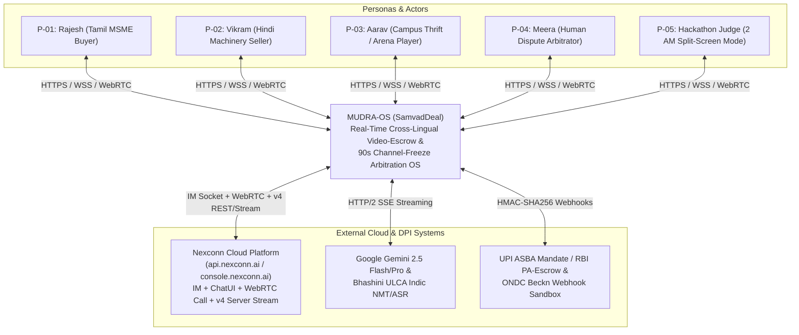
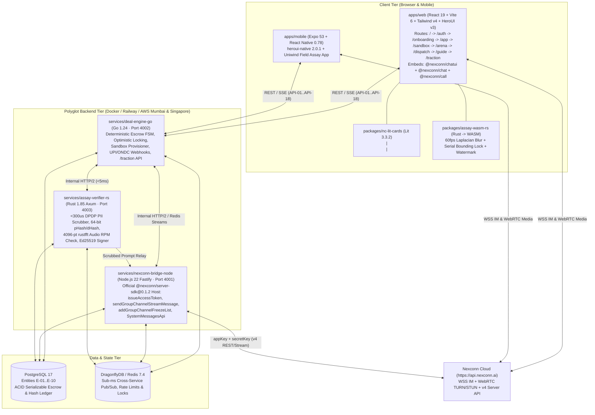
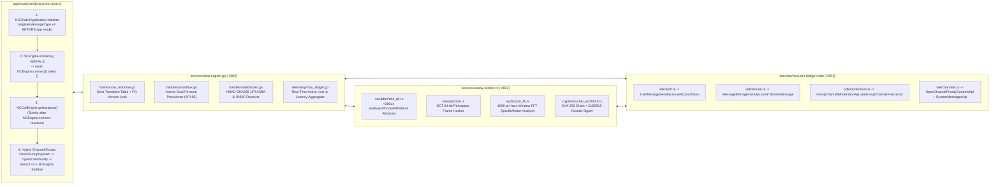
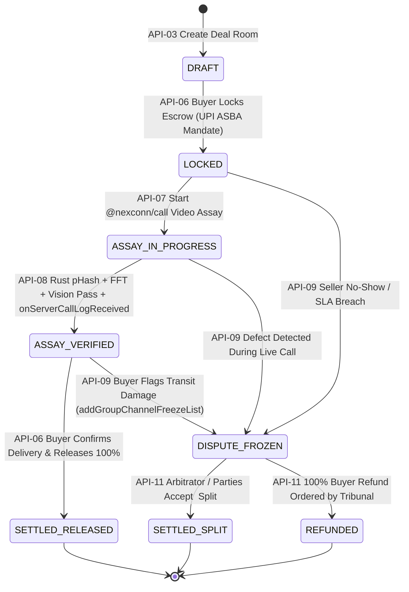
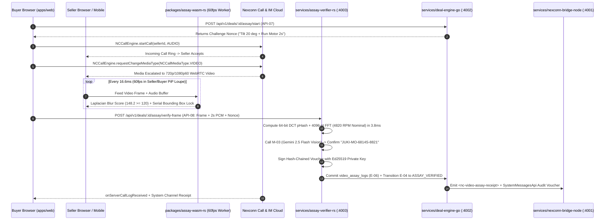

# System Architecture (C4 Model & Polyglot Flows) - MUDRA-OS (`SamvadDeal`)
> Project: **MUDRA-OS (`SamvadDeal`)** · Owner: Team `Chanakya` (Chief Systems Architect) · Status: Draft v0.1 · Last updated: 2026-11-10
> Related: [Project Brief](../00-overview/PROJECT_BRIEF.md) · [Tech Stack](./TECH_STACK.md) · [Data Model](./DATA_MODEL.md) · [API Spec](./API_SPEC.md) · [Nexconn SDK Manual](./NEXCONN_SDK_MANUAL.md) · [ADR-0001](./adr/ADR-0001-polyglot-go-rust-node-nexconn-architecture.md)

---

## 1. Architectural Philosophy: Non-Dual Protocol Unity + Systems Speed

MUDRA-OS is architected around two non-negotiable engineering axioms:
1. **The Nexconn Channel IS the State Machine**: Instead of treating chat as a side widget next to external web forms, `<nc-chat-ui-app-provider>` (`@nexconn/chatui@^26.2.5`), `NCEngine` (`@nexconn/chat@^26.2.1`), `NCCallEngine` (`@nexconn/call@^26.2.0`), and `@nexconn/server-sdk@0.1.2` form the unified real-time bus for negotiation, custom Lit escrow milestone cards, live WebRTC video inspection, and channel-freeze arbitration.
2. **Zero-Python Polyglot Systems Performance (`ADR-0001`)**:
   - **Go 1.24 (`services/deal-engine-go`, `:4002`)**: Executes lock-free/serializable escrow finite-state machine transitions (`<1.2ms` p99), optimistic concurrency checks, high-throughput `Open` channel auction bids, and HMAC-verified UPI/ONDC webhooks.
   - **Rust 1.85 (`services/assay-verifier-rs`, `:4003` + `packages/assay-wasm-rs`)**: Executes `<300µs` Aho-Corasick DPDP PII scrubbing before LLM transit, 60fps browser WebAssembly blur/serial bounding-box lock, `<5ms` server-side 64-bit perceptual image hashing (`pHash`), 4096-point `rustfft` audio motor/fan RPM analysis, and Ed25519 cryptographic voucher signing.
   - **Node.js 22 LTS (`services/nexconn-bridge-node`, `:4001`)**: Hosts the official TypeScript `@nexconn/server-sdk@0.1.2` (`UserManagementApi`, `MessageManagementApi`, `GroupChannelManagementApi`, `GroupChannelModerationApi`, `OpenChannelPriorityControlsApi`, `CommunityChannelManagementApi`, `SystemMessagesApi`, `ModerationApi`).

---

## 2. C4 Level 1 - System Context Diagram

---

## 3. C4 Level 2 - Container Diagram

---

## 4. C4 Level 3 - Component Architecture of the Three Backend Services & Client Bridge

---

## 5. Key Sequence Diagrams

### 5.1 Deterministic Escrow FSM State Machine (`services/deal-engine-go`)

### 5.2 Live WebRTC Video Assay + Rust Forensics + `System` Voucher Sequence

---

## 6. Scalability, Offline/Low-Bandwidth Resilience & Failure Modes

| Failure Mode / Bottleneck | Architectural Mitigation | Linked ADR / Risk |
|---|---|---|
| **WebRTC Call Signaling Before IM Socket Ready** | `nexconn-boot.ts` state machine strictly awaits `NCEngine.connect({ token })` before instantiating `NCCallEngine`. | `R-01`, `ADR-0002` |
| **Corporate Firewall / Symmetric NAT Blocks UDP WebRTC** | Automatic fallback after `2,500ms` ICE timeout to **High-Cadence Signed Keyframe Relay** (`packages/assay-wasm-rs` → `NCEngine` → `API-08`). | `R-10` |
| **Judge Evaluates at 2 AM Without a Webcam** | Built-in **Simulated HD Inspection Video Stream** canvas injector feeds real 60fps Juki overlock / MacBook footage into `NCCallEngine` and Rust WASM. | `R-04` |
| **Concurrent Conflicting Escrow Clicks (Race Condition)** | Go 1.24 FSM uses PostgreSQL `SELECT ... FOR UPDATE` + monotonic `version` column (`409 Conflict` on stale state). | `ADR-0001`, `ADR-0005` |
| **LLM Streaming Interruption Mid-Sentence** | `services/nexconn-bridge-node` wraps `sendGroupChannelStreamMessage` in a `1,800ms` watchdog that seamlessly switches from Gemini 2.5 Flash (`M-01`) to Bhashini / Together AI. | `ADR-0006` |
| **High-Traffic Flash Auction Flood in `Open` Channel** | `OpenChannelPriorityControlsApi` whitelists verified sellers; Go 1.24 + DragonflyDB handles `10,000+` concurrent bid reads per second. | `ADR-0002` |
