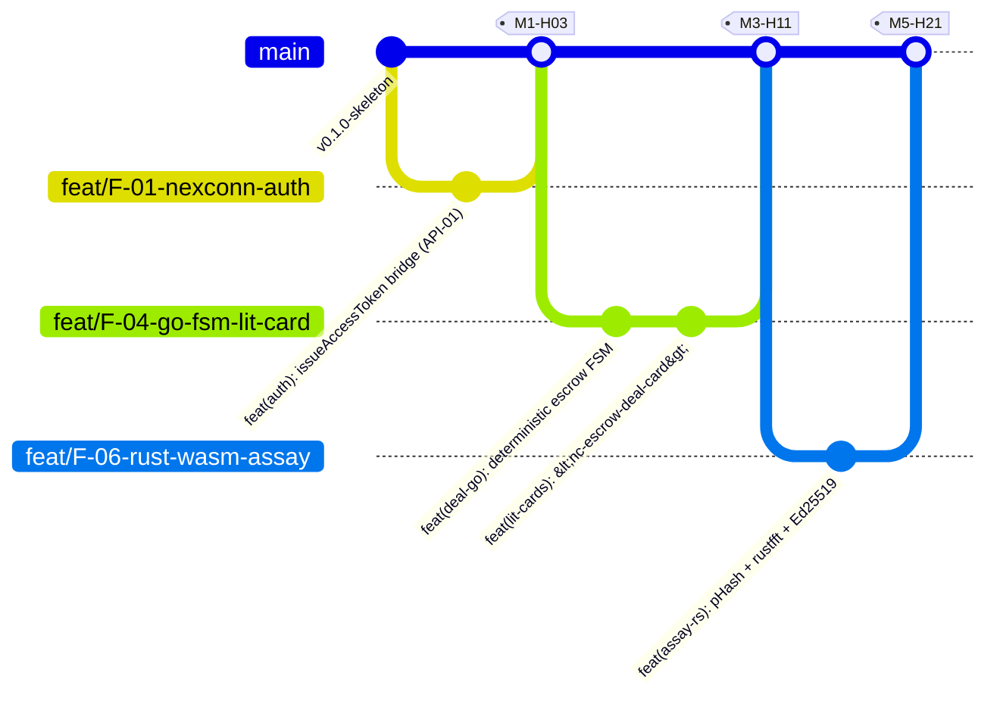

# Git Workflow & Release Versioning - MUDRA-OS (`SamvadDeal`)
> Project: **MUDRA-OS (`SamvadDeal`)** · Owner: Team `Chanakya` (Release Engineering Lead) · Status: Draft v0.1 · Last updated: 2026-11-10
> Related: [Project Brief](../00-overview/PROJECT_BRIEF.md) · [Coding Standards](./CODING_STANDARDS.md) · [CI/CD](../05-ops/CICD.md) · [Contributing](../../.github/CONTRIBUTING.md)

---

## 1. Branching Strategy: High-Velocity Trunk-Based Development

For a 4-engineer team executing a 36-hour hackathon sprint (`HACKATHON_PLAN.md`) followed by live MAU traction campaigns, long-lived feature branches cause painful merge conflicts. We use **Trunk-Based Development** with short-lived feature branches (`<4 hours` lifetime):



- **`main` branch**: Always deployable; protected by GitHub Actions CI (`ci.yml`: Go, Rust, Node, Web + `sloplint`).
- **Branch Naming Convention**:
  - `feat/F-<id>-<short-slug>` (e.g., `feat/F-05-nexconn-call-pip-loupe`, `feat/F-07-channel-freeze-tribunal`)
  - `fix/<issue>-<short-slug>` (e.g., `fix/R-01-ncengine-connect-barrier`)
  - `docs/<section>-<short-slug>`
  - `perf/<service>-<short-slug>`

---

## 2. Commit Message Convention (Conventional Commits 1.0)

Every commit message follows:
```text
<type>(<scope>): <concise imperative summary> [<Feature/Risk ID>]
```
- **Allowed `<type>` values**: `feat`, `fix`, `perf`, `refactor`, `test`, `docs`, `ci`, `chore`.
- **Allowed `<scope>` values**: `web`, `mobile`, `lit-cards`, `assay-wasm`, `deal-go`, `assay-rs`, `nc-bridge`, `ai`, `infra`, `docs`.
- **Examples**:
  - `feat(nc-bridge): stream bilingual translations via sendGroupChannelStreamMessage [F-03]`
  - `feat(assay-rs): add 4096-pt Hann FFT spindle RPM verifier and Ed25519 signer [F-06]`
  - `fix(web): await NCEngine.connect before initializing NCCallEngine [R-01]`

---

## 3. Pull Request & Milestone Tagging Rules

1. **Atomic PRs**: Every PR maps to a specific Feature ID (`F-01`..`F-14`) or Backlog ticket (`BACKLOG.md`).
2. **Automated Pre-Merge Checks (`.github/workflows/ci.yml`)**:
   - `gitleaks` secret check (verifies `NEXCONN_SECRET_KEY` and `GEMINI_API_KEY` are never committed).
   - Go `1.24` build & `go test -race ./...`.
   - Rust `1.85` `cargo test` & `wasm-pack build`.
   - Node `22` + React `19` typecheck, Vitest unit tests, and `sloplint --render`.
3. **Semantic Versioning & Sprint Tags**:
   - `v0.1.0` - Initial Bible & Polyglot Skeleton (`H00`)
   - `v0.2.0` - Core Nexconn Auth, Go FSM & Lit Escrow Card (`M3 / H11`)
   - `v0.3.0` - Live WebRTC `@nexconn/call` + Rust WASM Assay + Freeze Tribunal (`M6 / H26`)
   - `v1.0.0-nexconn-submission` - Full 9-Route Story UX, 500+ Verified MAUs & Final Submission (`M8 / H36`)
