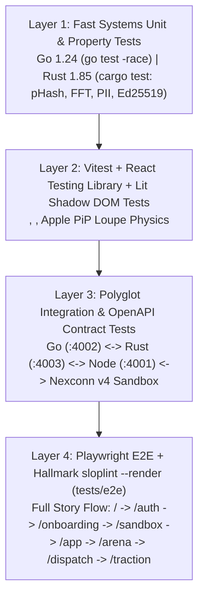

# Testing Strategy & Verification Suite — SAMADHAN-OS (`SamvadDeal`)
> Project: **SAMADHAN-OS (`SamvadDeal`)** · Owner: Team `Chanakya` (QA, E2E & Verification Lead — Dev 4) · Status: Draft v0.1 · Last updated: 2026-11-10
> Related: [Project Brief](../00-overview/PROJECT_BRIEF.md) · [User Stories](../01-product/USER_STORIES.md) · [Performance](./PERFORMANCE.md) · [CI/CD](../05-ops/CICD.md)

---

## 1. The Polyglot Testing Pyramid



| Test Layer | Tooling | Target Coverage / Gate | Execution Time |
|---|---|---|---|
| **Go 1.24 Unit & Race Tests** | `go test -v -race -coverprofile=coverage.out ./...` | `>= 90%` on `internal/fsm` & `internal/handlers` (`0` data races) | `< 1.8 seconds` |
| **Rust 1.85 & WASM Unit Tests** | `cargo test --workspace` + `wasm-pack test --headless --chrome` | `>= 92%` on `scrubber.rs`, `phash.rs`, `audio_fft.rs`, `voucher_crypto.rs` | `< 2.4 seconds` |
| **Frontend & Lit Component Tests** | **Vitest 3.0** + **React Testing Library** + `@open-wc/testing` | `>= 85%` across `nexconn-boot.ts`, `apple-physics.ts`, and all 4 Lit cards | `< 3.5 seconds` |
| **Design & Slop Gate** | `node scripts/sloplint.mjs --render` | **`0 FAIL`**, all Hallmark Floor & Unslop checks green at `1280x800` & `1920x1080` | `< 8.0 seconds` |
| **Playwright E2E Story Suite** | **Playwright 1.51** (`tests/e2e/*.spec.ts` with Page Object Model) | `100%` of `US-01`..`US-16` critical journeys pass in Chromium & WebKit | `< 35 seconds` |
| **Load & Concurrency Suite** | **k6** (`tests/load/escrow_spike.js`) | `500 VUs` concurrent FSM transitions & Open channel bids (`p99 < 15ms`, `0` errors) | `< 30 seconds` |

---

## 2. Critical Unit & Concurrency Tests

### 2.1 Go 1.24 Concurrent Escrow Race Test (`services/deal-engine-go/internal/fsm/escrow_fsm_test.go`)
Spawns **50 goroutines simultaneously** attempting conflicting transitions (`RELEASE_FUNDS` vs. `RAISE_DISPUTE`) on the same `deal_room_id` at `version = 2` against PostgreSQL 17.
- **Pass Criterion**: Exactly **1** goroutine receives HTTP `200 OK` (`version = 3`), and **49** goroutines receive HTTP `409 Conflict` (`ERR_FSM_CONFLICT`). Final DB row is 100% deterministic.

### 2.2 Rust 1.85 Forensic & DPDP Scrubber Benchmarks (`services/assay-verifier-rs`)
1. `test_dpdp_pii_scrubber_under_300us`: Feeds 100 synthetic Tamil/Hindi/English messages containing formatted/unformatted Aadhaar (`2345 6789 0123`), PAN (`ABCDE1234F`), Indian mobile (`+91-9876543210`), and UPI IDs (`rajesh@okaxis`). Asserts `100%` redaction in `<300µs` per message.
2. `test_phash_invariance_and_tamper_detection`: Asserts that re-compressed JPEG frames of the same Juki MO-6814S machine have Hamming distance `<= 4`, while a swapped/cracked bracket frame has Hamming distance `>= 14`.
3. `test_fft_4820_rpm_peak`: Synthesizes a `48kHz` sine wave at `80.33 Hz` (`4,820 RPM`) with `-12dB` workshop noise and asserts `extract_motor_rpm()` returns `4820.0 ± 15.0 RPM`.
4. `test_ed25519_voucher_chain_tamper_reject`: Mutates 1 byte in voucher #2 of a 4-voucher `System` chain and asserts `verify_voucher_chain()` returns `Err(VoucherTamperedAt(2))`.

---

## 3. Playwright E2E Story Tests (`tests/e2e/`)

1. **`story-onboarding-and-auth.spec.ts` (`US-01`, `US-02`)**:
   - Navigates to `/` at `1280x800` → verifies headline, 1 sentence, and primary CTA are visible above the fold without scrolling → clicks `Sign in` (`/auth`) → clicks `1-Tap Rajesh (Tamil Buyer)` → completes `/onboarding` with `Simulated HD Inspection Stream` enabled → verifies `/app` loads with `Stage 1` active on the top Story Bar.
2. **`split-screen-judge-sandbox.spec.ts` (`US-03`, `US-04`, `US-06`, `US-08`, `US-11`, `US-13`)**:
   - Clicks `Launch 1-click split-screen demo` on `/` → verifies Left Pane (`buyer_demo_*`) and Right Pane (`seller_demo_*`) connect via `NCEngine.connect` → executes all 5 Guided Story Coachmarks:
     1. Sends Tamil message on Left → asserts `<nc-bilingual-bubble>` streams Hindi/English on Right in `<1,000ms`.
     2. Clicks `Lock Escrow` in `<nc-escrow-deal-card>` → asserts `[SYS-VOUCHER]` receipt lands in `System` tab.
     3. Clicks `Verify on live video` → asserts `@nexconn/call` PiP Loupe opens, Rust WASM locks `JUKI-MO-6814S-8821`, and `<nc-video-assay-receipt>` renders.
     4. Clicks `Raise dispute` → asserts `addGroupChannelFreezeList` locks both inputs within `200ms` and `<nc-tribunal-verdict-card>` streams the `88% / 12%` split.
     5. Clicks `Approve split` → asserts deal transitions to `SETTLED_SPLIT`.

---

## 4. Synthetic Test Data Policy (Zero Real PII)

All seed scripts (`scripts/seed-demo-deals.ts`) and test fixtures use 100% synthetic personas (`Rajesh Natarajan`, `Vikramjeet Singh`, `Aarav Mehta`, `Meera Krishnan`), synthetic GSTINs, and synthetic UPI sandbox handles (`@okaxis-sandbox`). Zero real personal phone numbers, Aadhaar numbers, or bank accounts exist in the repository.

---

## 5. Manual 60-Second Pre-Demo Smoke Test Script

Before recording the demo video or submitting on `reskilll.com/hack/nexconn/dashboard`, run:
```bash
pnpm test:smoke-live
```
And manually verify in an Incognito Chrome window (`1280x800`):
1. Open `/` → Click **`Launch 1-click split-screen demo`** (`/sandbox`).
2. Follow Coachmarks `1 → 2 → 3 → 4 → 5`.
3. Open `/arena` → Play 15 seconds of bargaining against Chanakya AI Shopkeeper.
4. Open `/traction` → Confirm `Verified Nexconn MAUs` increments by `+3` (`buyer_demo`, `seller_demo`, `arena_player`).
