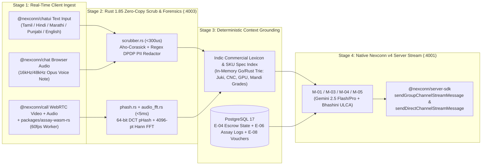

# AI Data Pipeline, Grounding & Lineage — SAMADHAN-OS (`SamvadDeal`)
> Project: **SAMADHAN-OS (`SamvadDeal`)** · Owner: Team `Chanakya` (Data & AI Pipeline Lead) · Status: Draft v0.1 · Last updated: 2026-11-10
> Related: [Project Brief](../00-overview/PROJECT_BRIEF.md) · [Models](./MODELS.md) · [Data Model](../03-engineering/DATA_MODEL.md) · [Privacy (DPDP)](../06-security-compliance/PRIVACY.md)

---

## 1. End-to-End Real-Time AI Data Pipeline

---

## 2. Data Sources, Licensing & Domain Grounding Corpora

We do not scrape private user chats. Our domain grounding lexicon (`ai/lexicon/`) is built exclusively from open, permissive public standards:

| Corpus / Data Source | URL / Reference | License / Legal Basis | How Used in SAMADHAN-OS |
|---|---|---|---|
| **Bhashini ULCA Open Parallel Corpora** | [https://bhashini.gov.in/ulca](https://bhashini.gov.in/ulca) | Govt of India Open Data License | Normalizes regional agricultural, textile, and MSME commercial terminology across Tamil, Hindi, Marathi, Punjabi, and Malayalam. |
| **ONDC Beckn Taxonomy & Issue Codes (IGM 2.0)** | [https://github.com/ONDC-Official](https://github.com/ONDC-Official) | Apache-2.0 / Open Protocol | Standardized dispute reason codes (`ITEM-001` damaged, `ITEM-002` spec mismatch, `FLM-003` delayed delivery) used by `M-04` Tribunal. |
| **e-NAM Commodity Assay & Moisture Standards** | [https://enam.gov.in](https://enam.gov.in) | Public Government Standard | Grounds wholesale lot grading (`open_flash_lots` `E-09`) for basmati rice, spices, and cotton lots. |
| **Industrial & Refurbished Hardware Spec Sheets** | Manufacturer public manuals (Juki MO-6814S nominal RPM `4,500–5,500`, GPU TDP/clock ranges) | Fair Use Factual Specifications | Grounds Rust `audio_fft.rs` (`4,820 RPM` pass window) and `M-03` Vision serial-plate verification. |

---

## 3. Low-Latency Hybrid Retrieval (Why We Use an In-Memory Rust/Go Trie Instead of Slow Vector DB Calls)

In a real-time chat room where our translation TTFT target is `<280ms`, making a `120ms` external vector-database network hop on every chat message is unnecessary overhead.
- **Architecture**:
  - For **SKU & Technical Term Grounding (`M-01`, `M-03`)**: We compile our 2,500-entry industrial/electronics/mandi glossary (`ai/lexicon/commercial_terms.json`) directly into an **in-memory Aho-Corasick Trie inside `services/assay-verifier-rs`**. In `<90 microseconds` (during the same pass as DPDP PII scrubbing!), it matches any mentioned machine model or colloquial unit (`"पेटी"`, `"லட்சம்"`, `"MO-6814S"`) and injects the exact canonical spec snippet (`120–250 tokens`) into the `M-01` prompt header.
  - For **Dispute Tribunal Evidence Retrieval (`M-04`)**: We retrieve the exact relational rows from PostgreSQL 17 (`escrow_contracts` `E-04`, `video_assay_logs` `E-06`, and Ed25519-signed `system_audit_vouchers` `E-08`) by indexed primary key (`deal_room_id`) in `<1.1ms`—providing 100% exact, hallucination-free evidence rather than fuzzy vector similarity!

---

## 4. Data Lineage, Refresh Cadence & DPDP Erasure Propagation

1. **Cryptographic Lineage**: Every AI output in `bilingual_messages` (`E-05`), `video_assay_logs` (`E-06`), and `dispute_cases` (`E-07`) logs the exact `model_id` (`gemini-2.5-flash`), `prompt_version` (`P-M01-v1.2`), `pii_scrub_time_us`, and `nexconn_msg_id`.
2. **Zero Model Training on User Data**: API calls to Google Gemini and Together AI explicitly set zero-data-retention / no-training headers.
3. **Instant Erasure Cascade**: When a user invokes Data Principal Erasure (`DELETE /api/v1/privacy/erase`), `bilingual_messages` and raw frame buffers are purged immediately while preserving only the non-PII cryptographic `system_audit_vouchers` hash chain required for financial compliance (`PRIVACY.md`).
