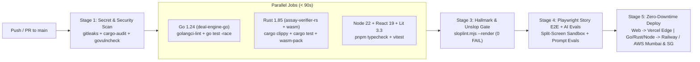

# CI/CD Pipeline Architecture - MUDRA-OS (`SamvadDeal`)
> Project: **MUDRA-OS (`SamvadDeal`)** · Owner: Team `Chanakya` (DevOps & Release Lead) · Status: Draft v0.1 · Last updated: 2026-11-10
> Related: [Project Brief](../00-overview/PROJECT_BRIEF.md) · [Git Workflow](../03-engineering/GIT_WORKFLOW.md) · [Testing](../03-engineering/TESTING.md) · [Deployment](./DEPLOYMENT.md) · [`ci.yml`](../../.github/workflows/ci.yml)

---

## 1. End-to-End CI/CD Pipeline Diagram



---

## 2. Complete GitHub Actions Workflows (Runnable YAML)

All three workflows are committed in `.github/workflows/`:
1. **`.github/workflows/ci.yml`**: Polyglot lint, secret scan, Go 1.24 race detector, Rust 1.85 + WASM build, Node 22 + React 19 + HeroUI v3 build, `sloplint --render`, and Playwright E2E tests.
2. **`.github/workflows/ai-evals.yml`**: Golden JSONL regression suite (`AI_EVALS.md`) testing Tamil/Hindi/Marathi/Punjabi contract extraction (`>=96.5%`), Rust `<300µs` DPDP PII redaction (`100%`), and red-team prompt injection immunity (`0%` bypass).
3. **`.github/workflows/deploy.yml`**: Automated preview deploys on PRs and zero-downtime blue/green production deploys on `main`.

### Inline Reference: `.github/workflows/ci.yml`
```yaml
name: MUDRA-OS Polyglot CI

on:
  push:
    branches: [main]
  pull_request:
    branches: [main]

concurrency:
  group: ${{ github.workflow }}-${{ github.ref }}
  cancel-in-progress: true

jobs:
  security-and-secrets:
    name: Secret Scan (No NEXCONN_SECRET_KEY in Client)
    runs-on: ubuntu-latest
    steps:
      - uses: actions/checkout@v4
        with:
          fetch-depth: 0
      - uses: gitleaks/gitleaks-action@v2
        env:
          GITHUB_TOKEN: ${{ secrets.GITHUB_TOKEN }}
      - name: Verify zero NEXCONN_SECRET_KEY references in apps/web
        run: |
          if grep -R "NEXCONN_SECRET_KEY" apps/web/; then
            echo "FATAL: NEXCONN_SECRET_KEY referenced in client bundle!"
            exit 1
          fi

  go-deal-engine:
    name: Go 1.24 Deal Engine & FSM Race Tests
    runs-on: ubuntu-latest
    defaults:
      run:
        working-directory: services/deal-engine-go
    steps:
      - uses: actions/checkout@v4
      - uses: actions/setup-go@v5
        with:
          go-version: "1.24"
          cache-dependency-path: services/deal-engine-go/go.sum
      - name: Run Go Race Detector & FSM Tests
        run: |
          if [ -f go.mod ]; then
            go vet ./...
            go test -v -race -coverprofile=coverage.out ./...
          fi

  rust-assay-and-wasm:
    name: Rust 1.85 Forensic Verifier & WebAssembly Build
    runs-on: ubuntu-latest
    steps:
      - uses: actions/checkout@v4
      - uses: dtolnay/rust-toolchain@stable
        with:
          toolchain: "1.85.0"
          targets: wasm32-unknown-unknown
          components: clippy, rustfmt
      - uses: Swatinem/rust-cache@v2
      - name: Test services/assay-verifier-rs (pHash, FFT, DPDP Scrubber, Ed25519)
        working-directory: services/assay-verifier-rs
        run: |
          if [ -f Cargo.toml ]; then
            cargo fmt --all -- --check
            cargo clippy --all-targets -- -D warnings
            cargo test --release
          fi
      - name: Build packages/assay-wasm-rs
        working-directory: packages/assay-wasm-rs
        run: |
          if [ -f Cargo.toml ]; then
            cargo check --target wasm32-unknown-unknown
          fi

  web-and-nexconn-bridge:
    name: Node 22 Bridge, React 19 HeroUI v3, Lit Cards & Hallmark Sloplint
    runs-on: ubuntu-latest
    needs: [security-and-secrets]
    steps:
      - uses: actions/checkout@v4
      - uses: pnpm/action-setup@v4
        with:
          version: 9.15.4
      - uses: actions/setup-node@v4
        with:
          node-version: "22"
          cache: "pnpm"
      - name: Validate OpenAPI 3.1 Contract (API-01..API-18)
        run: |
          if [ -f api/openapi.yaml ]; then
            grep -q "openapi: 3.1.0" api/openapi.yaml
            test "$(grep -c "operationId: API-" api/openapi.yaml)" -eq 18
          fi
      - name: Install, Typecheck, Unit Test & Hallmark Sloplint Gate
        run: |
          if [ -f package.json ]; then
            pnpm install --frozen-lockfile
            pnpm -r typecheck
            pnpm -r test:unit
            npx sloplint --render http://localhost:5173
          fi
```

---

## 3. Environments, Secrets Management & Preview Deploys

| Environment | URL Pattern | Secrets Source | Purpose |
|---|---|---|---|
| **Local Dev** | `http://localhost:5173` (`:4001`..`:4003`) | Local `.env` (gitignored) | Developer workstation & `/sandbox` testing |
| **PR Preview** | `https://pr-<num>-mudra-os.vercel.app` | GitHub Environment `preview` + Neon DB Branch | Automated Playwright E2E + `sloplint --render` review |
| **Production (Judge Live)** | `https://mudra-os.dev` (`api.mudra-os.dev`) | GitHub Environment `production` + AWS Secrets Manager / Railway | Live URL submitted on `https://reskilll.com/hack/nexconn/dashboard` |

---

## 4. Instant Rollback Strategy

- **Frontend (`apps/web`)**: 1-click instant alias rollback on Vercel / Cloudflare Pages (`<5 seconds`).
- **Polyglot Backend (`deal-engine-go`, `assay-verifier-rs`, `nexconn-bridge-node`)**: Immutable Docker images tagged by Git SHA (`ghcr.io/chanakya-team/mudra-*:sha-<commit>`). If post-deploy `/health` or synthetic `/api/v1/sandbox/provision` check fails within `60s`, the deployment orchestrator automatically keeps traffic on the previous healthy container revision.
