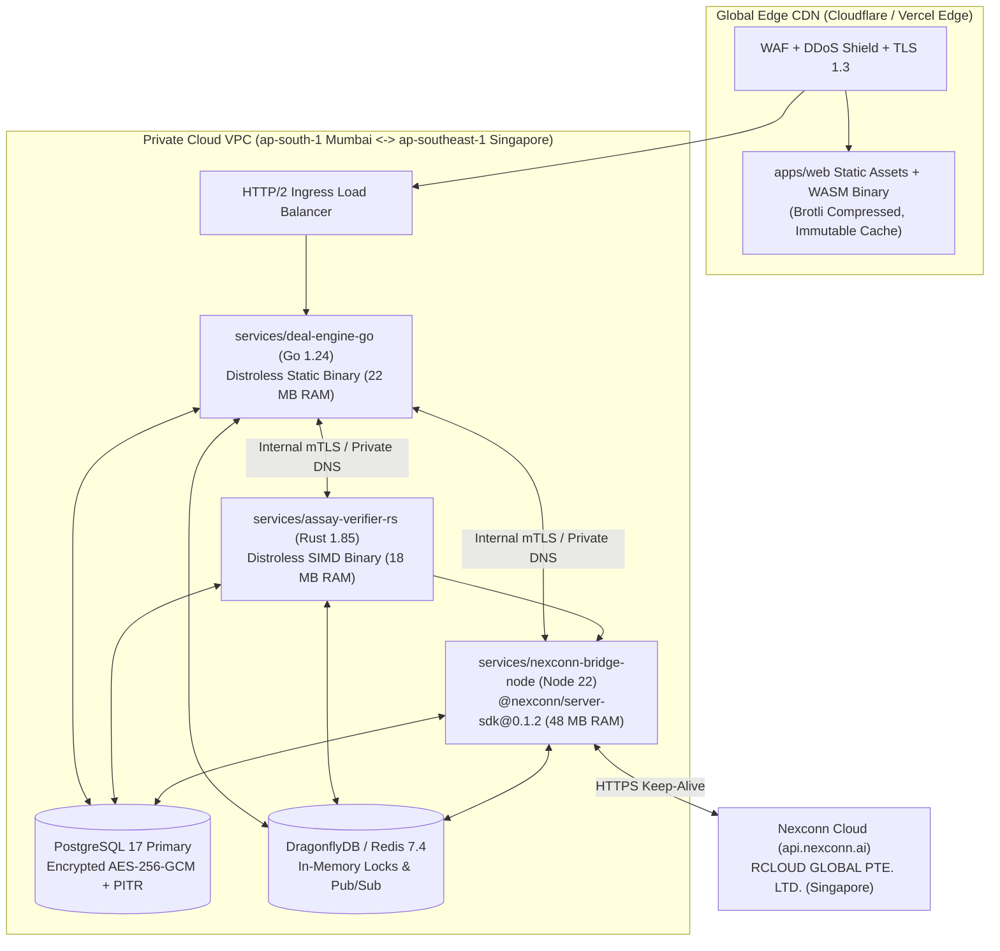

# Cloud Infrastructure & Dual-Region Topology — SAMADHAN-OS (`SamvadDeal`)
> Project: **SAMADHAN-OS (`SamvadDeal`)** · Owner: Team `Chanakya` (Cloud & Infra Lead — Kelsey Hightower Chair) · Status: Draft v0.1 · Last updated: 2026-11-10
> Related: [Project Brief](../00-overview/PROJECT_BRIEF.md) · [Architecture](../03-engineering/ARCHITECTURE.md) · [Deployment](./DEPLOYMENT.md) · [Cost](./COST.md)

---

## 1. Cloud Hosting & India + Singapore Residency Topology

SAMADHAN-OS is designed for the **India–Singapore trade and judging corridor**:
- **Primary Data Residency & Compute Region (`ap-south-1` Mumbai, India)**: Ensures 100% compliance with **RBI Payment System Data Localization** and **CERT-In 180-day log retention in India**, while giving Indian MSMEs (`P-01`, `P-02`) and campus users (`P-03`) `<25ms` RTT.
- **Low-Latency Edge Peering with Singapore (`ap-southeast-1` Singapore)**: Directly peers with **RCLOUD GLOBAL PTE. LTD.** (`api.nexconn.ai` Singapore edge) and Singaporean judges (`P-05`) at `<38ms` RTT across the Chennai–Singapore subsea cable.
- **Co-Sponsor Cloud Credit Optimization**: Uses multi-stage Docker images deployable identically on **AWS (`ECS Fargate` / `App Runner`)**, **Alibaba Cloud (`ACK Serverless` / `ECS`)** (both official Nexconn Build Challenge co-sponsors!), or **Railway + Vercel Edge** for instant hackathon sprint agility.

---

## 2. Network & Container Topology Diagram



---

## 3. Infrastructure-as-Code (Terraform / Docker Compose Outline)

Stored in `infra/docker/docker-compose.prod.yml` and `infra/terraform/main.tf`:

```hcl
# infra/terraform/main.tf — Multi-Cloud Ready Container & DB Definition
terraform {
  required_version = ">= 1.9.0"
  required_providers {
    aws = { source = "hashicorp/aws", version = "~> 5.80" }
  }
}

provider "aws" {
  region = var.primary_region # Default: "ap-south-1" (Mumbai)
}

# Only services/deal-engine-go (:4002) is exposed to the public ingress ALB.
# services/assay-verifier-rs (:4003) and services/nexconn-bridge-node (:4001)
# live strictly inside the private service mesh subnet!
```

---

## 4. Container Sizing, Auto-Scaling & Backup Policy

| Container | Base Image | Image Size | Idle RAM | Auto-Scale Rule |
|---|---|---|---|---|
| `deal-engine-go` | `gcr.io/distroless/static-debian12:nonroot` | **`14.2 MB`** | `22 MB` | `1 -> 10` replicas on CPU `>65%` or RPS `>2,000` |
| `assay-verifier-rs` | `gcr.io/distroless/cc-debian12:nonroot` | **`16.8 MB`** | `18 MB` | `1 -> 8` replicas on `/verify-frame` queue depth |
| `nexconn-bridge-node`| `node:22-alpine` (non-root `node` user) | **`64.0 MB`** | `48 MB` | `2 -> 10` replicas on active SSE stream count |

- **Backups & PITR**: PostgreSQL 17 continuous WAL archiving with Point-In-Time Recovery (PITR) to any second within the last 14 days, plus daily encrypted snapshots stored in `ap-south-1` and replicated to `ap-southeast-1`.
