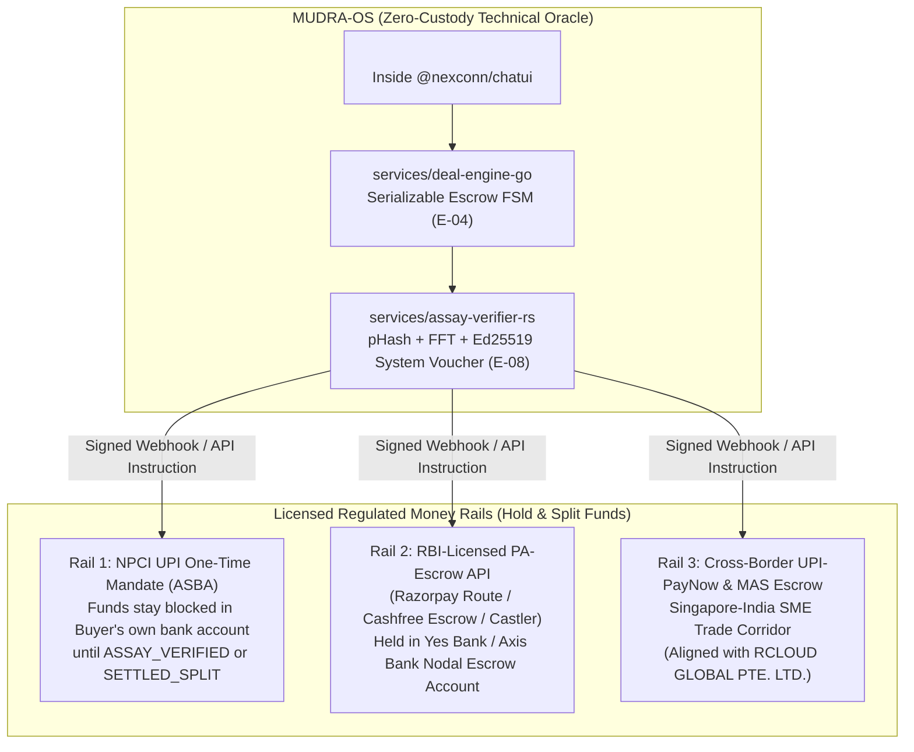

# Regulatory Sandbox & DPI Escrow Architecture (RBI / NPCI / ONDC / MAS) - MUDRA-OS (`SamvadDeal`)
> Project: **MUDRA-OS (`SamvadDeal`)** · Owner: Team `Chanakya` (Fintech & Regulatory Architecture Lead - Nandan Nilekani, T. Koshy & Harvey Specter Chair) · Status: Draft v0.1 · Last updated: 2026-11-10
> Related: [Project Brief](../00-overview/PROJECT_BRIEF.md) · [Compliance](./COMPLIANCE.md) · [Integrations](../03-engineering/INTEGRATIONS.md) · [Business Model](../07-business/BUSINESS_MODEL.md)

---

## 1. Why a Technical Orchestration & Regulatory Sandbox Architecture Matters

When building an escrow and dispute-resolution platform in India and Singapore, the single biggest legal landmine (`R-08`) is **unlicensed fund pooling**. Under the **Reserve Bank of India (RBI) Master Direction on Payment Aggregators (PAs)** and the **Monetary Authority of Singapore (MAS) Payment Services Act 2019**, a software company cannot hold buyer deposits in its own corporate current account and disburse them later without a PA/escrow license.

**MUDRA-OS solves this with a 100% compliant "Zero-Custody Technical Orchestrator" architecture**:
- MUDRA-OS **never takes custody of fiat currency**.
- Instead, our Go 1.24 FSM (`services/deal-engine-go`) and Rust Ed25519 voucher engine (`services/assay-verifier-rs`) act as the **cryptographic condition-verification oracle** that instructs licensed banking rails when to block, release, or split funds.

---

## 2. The Three Production-Ready Financial Rails

### 2.1 Rail 1: NPCI UPI One-Time Mandate with Block (`UPI ASBA` for Deals `<= ₹1,00,000`)
- **How It Works**: Using NPCI's **UPI Single-Block-and-Multiple-Debit / One-Time Mandate** spec, when a buyer (`P-03` Aarav buying a `₹28,000` used GPU) clicks `Lock Escrow` in `<nc-escrow-deal-card>`, the ₹28,000 is **blocked inside Aarav's own savings account** (`umn: mudra.8819@okaxis`).
- **Regulatory Advantage**: Zero money leaves the buyer's bank until `@nexconn/call` video inspection passes (`ASSAY_VERIFIED`). If a dispute results in a `12%` repair rebate (`buyer_refund_bps: 1200`, `seller_payout_bps: 8800`), the mandate executes a partial debit of `88%` (`₹24,640`) to the seller and unblocks the remaining `12%` (`₹3,360`) instantly!

### 2.2 Rail 2: RBI-Licensed Nodal Escrow Partner (`Razorpay Route` / `Cashfree Escrow` / `Castler` for B2B Deals `> ₹1,00,000`)
- **How It Works**: For larger B2B machinery deals (`P-01` Rajesh buying a `₹1,45,000` Juki overlock machine from `P-02` Vikram), `services/deal-engine-go` creates a linked-account escrow order with `on_hold: true` inside a licensed Payment Aggregator's bank-hosted nodal account.
- **Trigger**: Only when `services/assay-verifier-rs` emits an Ed25519-signed `SETTLED_RELEASED` or `SETTLED_SPLIT` voucher (`E-08`) does the Go engine call the PA Transfer Release API.

### 2.3 Rail 3: ONDC Issue & Grievance Management (`IGM 2.0`) & RBI Enabling Framework for Regulatory Sandbox
- **ONDC Alignment**: Every `dispute_cases` (`E-07`) and `system_audit_vouchers` (`E-08`) record maps 1:1 to the **ONDC Beckn `issue` / `on_issue_status`** schema, allowing MUDRA-OS to plug directly into the Open Network for Digital Commerce as a real-time **Video Assay & ODR Technical Service Provider (TSP)**.
- **RBI Regulatory Sandbox Application Path (2027 Cohort)**: Prepared under the *RBI Enabling Framework for Regulatory Sandbox (Updated 2024)* under the theme **"Cross-Border & Programmable MSME Trade Payments with Real-Time Multimodal Fraud Prevention."**
