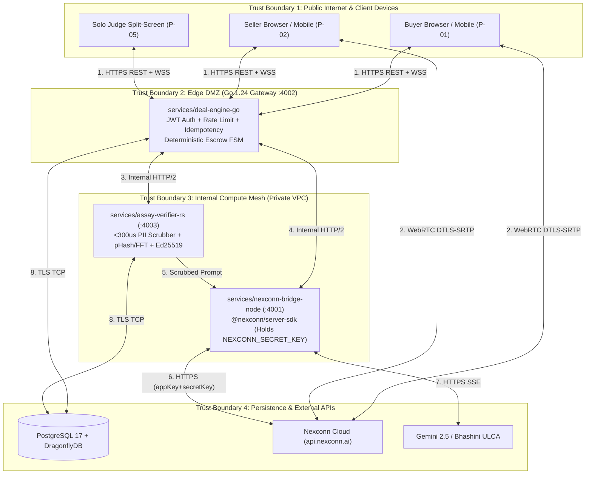

# Threat Model (STRIDE & Abuse Cases) - MUDRA-OS (`SamvadDeal`)
> Project: **MUDRA-OS (`SamvadDeal`)** · Owner: Team `Chanakya` (Security & Red-Team Lead - Nicholas Carlini & Troy Hunt Chair) · Status: Draft v0.1 · Last updated: 2026-11-10
> Related: [Project Brief](../00-overview/PROJECT_BRIEF.md) · [Security Architecture](./SECURITY_ARCHITECTURE.md) · [Risk Register](./RISK_REGISTER.md)

---

## 1. Data Flow Diagram (DFD) with Trust Boundaries

---

## 2. STRIDE Threat Analysis by Component

| Component | Threat Category (STRIDE) | Specific Attack Scenario | Mitigation Implemented | Residual Risk |
|---|---|---|---|---|
| **Client (`apps/web` & Lit Cards)** | **S**poofing / **T**ampering | Attacker modifies DOM attributes on `<nc-escrow-deal-card>` to enable `Release Funds` button prematurely. | UI state is cosmetic; Go `deal-engine-go` (`API-06`) checks JWT identity (`BuyerUserID`) and DB `fsm_state` + `version`. | Negligible |
| **Go Deal Engine (`:4002`)** | **E**levation of Privilege / Race | Attacker sends 100 parallel `POST /escrow/transition` requests hoping to trigger double payout or bypass `DISPUTE_FROZEN`. | `X-Idempotency-Key` lock in DragonflyDB + PostgreSQL `UPDATE ... WHERE version = $expected` (`go test -race` verified). | Negligible |
| **Rust Assay Verifier (`:4003`)** | **I**nformation Disclosure | User types Aadhaar/phone/bank number in chat; leaked to external LLM logs. | `scrubber.rs` (`Aho-Corasick` + `RegexSet`) redacts all Indian & Singaporean PII patterns in `<300µs` before LLM transit. | Low |
| **Node Nexconn Bridge (`:4001`)** | **T**ampering / Prompt Injection | Seller sends Tamil/Hindi prompt injection to trick `M-01` or `M-04` into outputting a `100%` seller release verdict. | `<untrusted_user_speech>` XML delimiters + `M-04` reads evidence only from Ed25519-verified DB rows + human/bilateral sign-off gate. | Low |
| **WebRTC Video Assay (`@nexconn/call`)** | **R**epudiation / Spoofing | Seller plays a pre-recorded video of a working machine or claims after the call that they never agreed to the inspection. | `API-07` dynamic challenge nonce + Rust `pHash`/FFT + `onServerCallLogReceived` call ID bound to an Ed25519 `System` channel voucher. | Low |
| **Open Channel Ticker (`F-10`)** | **D**enial of Service (Spam Raid) | Bot floods the `Open` marketplace channel with fake flash-lot messages during judging. | `OpenChannelPriorityControlsApi` (`API-13`) whitelists only verified sellers as priority broadcasters; `ModerationApi` mutes raiders. | Low |

---

## 3. Domain-Specific Marketplace Abuse Cases & Countermeasures

1. **Abuse Case 1 - The "Static Screen Replay" Scam**:
   - *Attack*: Seller points their phone camera at a laptop monitor showing a photo of a pristine Juki machine or GPU.
   - *Countermeasure*: (a) `API-07` issues a live challenge (*"Tilt camera 20° left and run motor for 2 seconds"*). (b) Client WASM checks Moiré screen-grid interference and specular highlights. (c) Rust `audio_fft.rs` verifies the live `4,820 RPM` acoustic signature simultaneously.
2. **Abuse Case 2 - Post-Dispute Intimidation & Evidence Deletion**:
   - *Attack*: Once Buyer spots a defect, Seller floods the chat with abusive messages or tries to overwrite the conversation context.
   - *Countermeasure*: Clicking `Raise Dispute` (`API-09`) immediately invokes `@nexconn/server-sdk`'s `GroupChannelModerationApi.addGroupChannelFreezeList` (`POST /v4/group-channel/moderation/freeze/add`), locking the channel in `<150ms`.
3. **Abuse Case 3 - Synthetic MAU Bot Farming Accusation (`R24`)**:
   - *Attack/Critique*: Hackathon auditor suspects active users on `console.nexconn.ai` are fake loop scripts.
   - *Countermeasure*: Every session in `nexconn_sessions` (`E-02`) is tied to a real interactive browser session (`/sandbox` split-screen tour or `/arena` 60-second human bargaining turns) with full event telemetry visible on `/traction`.
