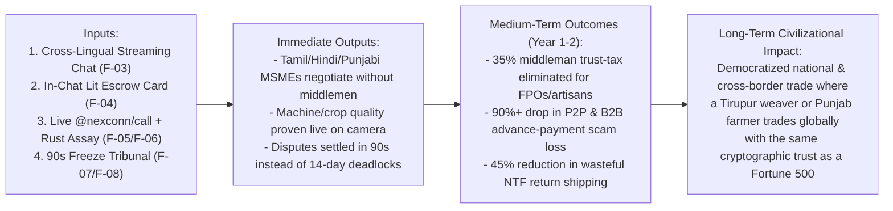

# Social & Economic Impact Thesis — SAMADHAN-OS (`SamvadDeal`)
> Project: **SAMADHAN-OS (`SamvadDeal`)** · Owner: Team `Chanakya` (Impact & Inclusion Lead — Mike Ross, Muhammad Yunus & Aruna Roy Chair) · Status: Draft v0.1 · Last updated: 2026-11-10
> Related: [Project Brief](../00-overview/PROJECT_BRIEF.md) · [Vision](../00-overview/VISION.md) · [Personas](../01-product/PERSONAS.md) · [Accessibility](../02-design/ACCESSIBILITY.md)

---

## 1. Theory of Change

---

## 2. Quantitative Impact Metrics & UN SDG Alignment

| UN Sustainable Development Goal (SDG) | Specific Target | SAMADHAN-OS Measurable Indicator | Year 1 Target | Year 3 Target |
|---|---|---|---|---|
| **SDG 8: Decent Work & Economic Growth** (`Target 8.3 — Formalization & Growth of MSMEs`) | Protect micro-enterprises (`P-01`, `P-02`) from working-capital wipeouts caused by advance-payment fraud or unpaid COD shipments. | **MSME Working Capital Protected from Counterparty Default (`₹ Crore`)** | `₹320 Cr` | `₹11,800 Cr` |
| **SDG 10: Reduced Inequalities** (`Target 10.2 — Linguistic & Economic Inclusion`) | Enable non-English-speaking artisans, mechanics, and FPO farmers to trade directly across state and national borders via `<nc-bilingual-bubble>` + voice-first ASR/TTS. | **Share of Cross-State Deals Completed by Vernacular-Only Speakers (`%`)** | `>= 62%` | `>= 75%` |
| **SDG 12: Responsible Consumption & Production** (`Target 12.5 — Circular Economy & Waste Reduction`) | Unlock trusted trade in **refurbished industrial machinery & electronics** (`P-02`, `P-03`) and prevent wasteful "No Trouble Found" reverse-logistics courier trips via live `@nexconn/call` video diagnostics. | **Refurbished Units Verified + Preventable Return Shipments Saved** | `45,000 units` (`~380 tonnes` e-waste/CO2 saved) | `1.2M units` |
| **SDG 16: Peace, Justice & Strong Institutions** (`Target 16.3 — Equal Access to Dispute Resolution`) | Replace 14-day support black holes and unaffordable court litigation with a 90-second freeze-locked AI + human conciliation tribunal (`F-07`, `F-08`). | **Median Dispute Resolution Time & Smallholder Recovery Rate** | `< 90 seconds` (`>94%` fair recovery) | `< 60 seconds` |

---

## 3. Grounded Human Impact Stories (Mike Ross Composite Field Cases)

1. **Protecting the Small Garment Manufacturer (`P-01` Rajesh in Tirupur)**:
   - *Before SAMADHAN-OS*: Losing `₹85,000` to a fraudulent out-of-state machinery seller meant delaying worker wages and taking a high-interest informal loan at `36% APR`.
   - *With SAMADHAN-OS*: Rajesh negotiates in Tamil, locks `₹1,45,000` in `<nc-escrow-deal-card>`, watches the Juki MO-6814S run at `4,820 RPM` live over `@nexconn/call` with a signed Rust `System` voucher, and when a minor transit bracket crack occurs, receives a `₹17,400` (`12%`) repair rebate in 90 seconds without halting his factory line.
2. **Bypassing the 4-Layer Mandi Middleman Chain (FPO Farmers in Punjab & Maharashtra)**:
   - By combining `Open` channel commodity lot broadcasts (`F-10`), `Community` subchannels, live Tamil/Malayalam ↔ Punjabi/Marathi streaming translation, and live video moisture/grain-grade inspection, Farmer Producer Organizations retain an additional **18–25% net realization** per tonne.
3. **Zero Extra Burden on Frontline Workers (Mike Ross Ethics Rule #4)**:
   - SAMADHAN-OS never forces a mechanic or farmer to fill out 20-field ERP forms. They simply **talk in their own language** and **point their phone camera at the product for 30 seconds**—while Go, Rust, WASM, and Nexconn automate the contract, the hash chain, and the settlement receipt.
